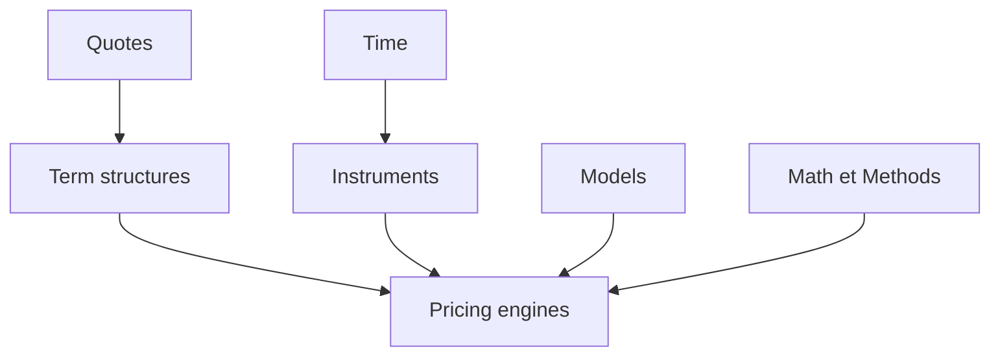

# lballabio/QuantLib

> C++ quantitative finance library: curves, derivatives and numerical methods, for quants.

## The problem
Pricing financial products and calibrating models requires reliable calendars, curves and numerical engines.

## What it actually does
It models dates, quotes, yield curves, instruments and cash flows. An instrument delegates its price to an engine (analytic, trees, finite differences, Monte Carlo). Stochastic processes (Black-Scholes, Heston, Hull-White) serve as the basis for calibratable models.

## How it is wired

## Trying it
No command documented in the README: installation is described on the project website.

## Cost and gotchas
Free. The license is present but not identified by GitHub; the README says it is free and non-copyleft. C++ build (CMake, autotools or Visual Studio).

## What it is not
It is not a market data service: you must supply your own quotes. No turnkey deployment.

## Alternatives
No alternative named in the README.

## For you
Keep an eye on it: a reference if you do quantitative finance or risk, otherwise of no interest for a general data / AI profile.
