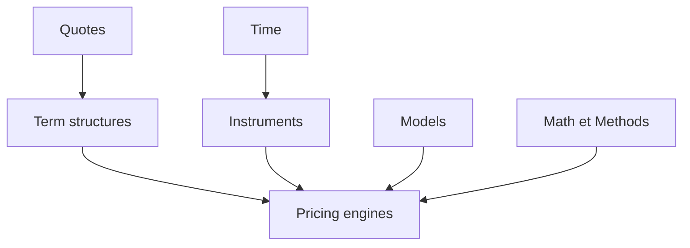

# lballabio/QuantLib

> Bibliothèque C++ de finance quantitative : courbes, produits dérivés et méthodes numériques, pour quants.

## Le problème
Valoriser des produits financiers et calibrer des modèles demande des calendriers, des courbes et des moteurs numériques fiables.

## Ce que ça fait vraiment
Elle modélise dates, cotations, courbes de taux, instruments et flux. Un instrument délègue son prix à un moteur (analytique, arbres, différences finies, Monte Carlo). Des processus stochastiques (Black-Scholes, Heston, Hull-White) servent de base aux modèles calibrables.

## Comment c'est branché

## Essayer
Aucune commande documentée dans le README : l'installation est décrite sur le site du projet.

## Coût et pièges
Gratuit. La licence est présente mais non identifiée par GitHub ; le README la dit libre et non copyleft. Compilation C++ (CMake, autotools ou Visual Studio).

## Ce que ce n'est pas
Ce n'est pas un service de données de marché : il faut fournir ses propres cotations. Pas de déploiement clé en main.

## Alternatives
Aucune alternative nommée dans le README.

## Pour toi
À surveiller : référence si tu fais de la finance quantitative ou du risque, sinon sans intérêt pour un profil data / IA généraliste.

