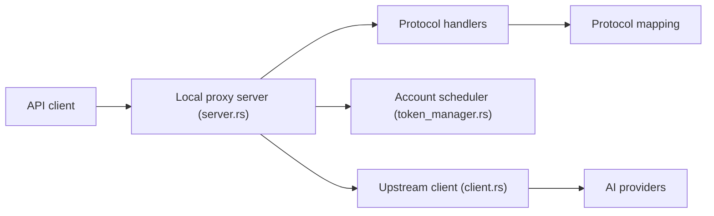

# lbjlaq/Antigravity-Manager

> Desktop application that turns Google/Anthropic accounts into a local API relay compatible with OpenAI, Anthropic and Gemini.

## The problem
Several AI accounts with separate quotas, different protocols and 429/401 errors to handle by hand in every client.

## What it actually does
- Dashboard of accounts and their quotas, added via OAuth 2.0 or JSON import.
- Local proxy (port 8045) exposing `/v1/chat/completions`, `/v1/messages` and the Gemini format.
- Account rotation and automatic retry on 429/401, model routing by series or regex.
- Config synchronization for Claude Code, OpenCode, JeikCode; image generation.

## How it is wired


## Trying it
```bash
curl -fsSL https://raw.githubusercontent.com/lbjlaq/Antigravity-Manager/main/install.sh | bash
# ou
docker run -d --name antigravity-manager -p 8045:8045 -e API_KEY=sk-your-api-key -e WEB_PASSWORD=your-login-password -v ~/.antigravity_tools:/root/.antigravity_tools lbjlaq/antigravity-manager:latest
```

## Cost and gotchas
No bill of its own, but you need accounts with the providers. The repository has 1,722 open issues. Installation via `curl | bash`; account tokens stored in `~/.antigravity_tools`.

## What it is not
Not an official API: it converts web sessions into an API. The README says nothing about the providers' terms of use; an account may be restricted. No license identified by GitHub.

## Alternatives
No alternative named in the README (JeikCode and Antigravity-Tools-LS are projects by the same author).

## For you
Ignore: unclear license, dependence on third-party web sessions and risk to your accounts; use the official APIs with keys instead.
