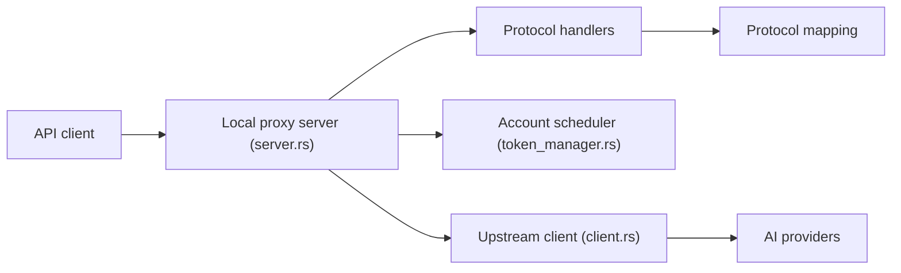

# lbjlaq/Antigravity-Manager

> Application de bureau qui fait de comptes Google/Anthropic un relais d'API local compatible OpenAI, Anthropic et Gemini.

## Le problème
Plusieurs comptes IA avec des quotas séparés, des protocoles différents et des erreurs 429/401 à gérer à la main dans chaque client.

## Ce que ça fait vraiment
- Tableau de bord des comptes et de leurs quotas, ajout par OAuth 2.0 ou import JSON.
- Proxy local (port 8045) exposant `/v1/chat/completions`, `/v1/messages` et le format Gemini.
- Rotation de comptes et nouvelle tentative automatique sur 429/401, routage de modèles par séries ou regex.
- Synchronisation de config pour Claude Code, OpenCode, JeikCode ; génération d'images.

## Comment c'est branché


## Essayer
```bash
curl -fsSL https://raw.githubusercontent.com/lbjlaq/Antigravity-Manager/main/install.sh | bash
# ou
docker run -d --name antigravity-manager -p 8045:8045 -e API_KEY=sk-your-api-key -e WEB_PASSWORD=your-login-password -v ~/.antigravity_tools:/root/.antigravity_tools lbjlaq/antigravity-manager:latest
```

## Coût et pièges
Pas de facture propre, mais il faut des comptes chez les fournisseurs. Le dépôt compte 1 722 issues ouvertes. Installation par `curl | bash` ; tokens de comptes stockés dans `~/.antigravity_tools`.

## Ce que ce n'est pas
Pas une API officielle : il convertit des sessions web en API. Le README ne dit rien des conditions d'usage des fournisseurs ; un compte peut être restreint. Pas de licence identifiée par GitHub.

## Alternatives
Aucune alternative nommée dans le README (JeikCode et Antigravity-Tools-LS sont des projets du même auteur).

## Pour toi
À ignorer : licence floue, dépendance à des sessions web de tiers et risque sur tes comptes ; utilise plutôt les API officielles avec clés.

