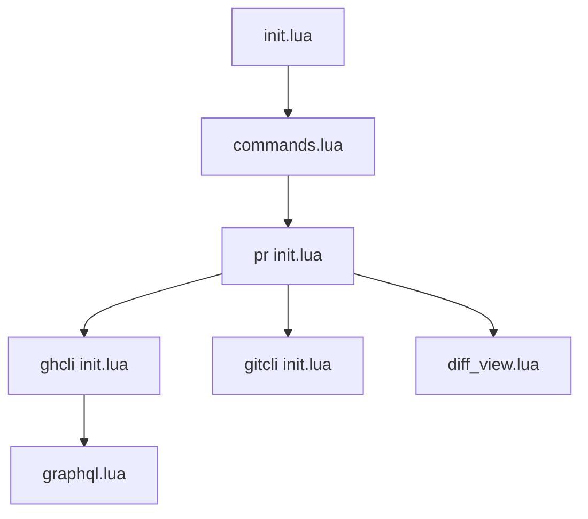

# ldelossa/gh.nvim

> Neovim plugin for reviewing GitHub pull requests locally with all the editor's features.

## The problem
Reviewing a big pull request in the web interface lacks context and LSP tooling.

## What it actually does
Fetches the pull request branch, adds it as a remote and checks it out locally. You browse commits, diffs, discussion threads and notifications in panels, with LSP, editing and code execution. It builds on litee.nvim.

## How it is wired


## Trying it
```lua
{
    "ldelossa/gh.nvim",
    dependencies = {
        { "ldelossa/litee.nvim", config = function() require("litee.lib").setup() end },
    },
    config = function() require("litee.gh").setup() end,
}
```

## Cost and gotchas
Free. Requires Neovim, the configured `git` and `gh` CLIs, and litee.nvim. Last push in January 2025.

## What it is not
Not an automatic AI review tool: everything is manual in the editor.

## Alternatives
No alternative named in the README.

## For you
Ignore: only useful if you review many PRs in Neovim, which the barely active repository no longer guarantees.
