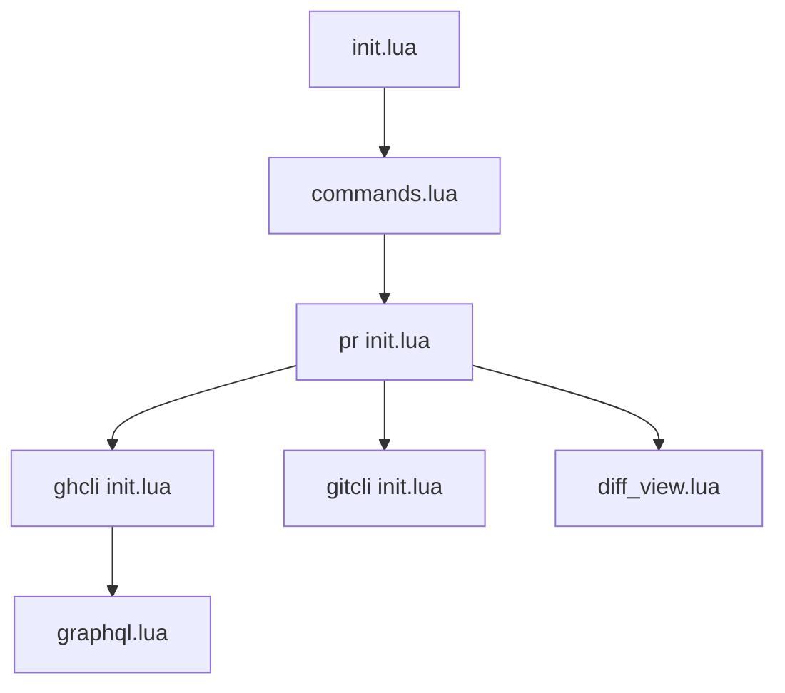

# ldelossa/gh.nvim

> Extension Neovim pour relire des pull requests GitHub en local avec toutes les fonctions de l'éditeur.

## Le problème
Relire une grosse pull request dans l'interface web manque de contexte et d'outils LSP.

## Ce que ça fait vraiment
Récupère la branche de la pull request, l'ajoute comme remote et la positionne en local. Tu parcours commits, diffs, fils de discussion et notifications dans des panneaux, avec LSP, édition et exécution du code. Il s'appuie sur litee.nvim.

## Comment c'est branché


## Essayer
```lua
{
    "ldelossa/gh.nvim",
    dependencies = {
        { "ldelossa/litee.nvim", config = function() require("litee.lib").setup() end },
    },
    config = function() require("litee.gh").setup() end,
}
```

## Coût et pièges
Gratuit. Requiert Neovim, les CLI `git` et `gh` configurées, et litee.nvim. Dernier push en janvier 2025.

## Ce que ce n'est pas
Pas un outil de revue automatique par IA : tout est manuel dans l'éditeur.

## Alternatives
Aucune alternative nommée dans le README.

## Pour toi
À ignorer : utile seulement si tu relis beaucoup de PR sous Neovim, ce que le dépôt peu actif ne garantit plus.

