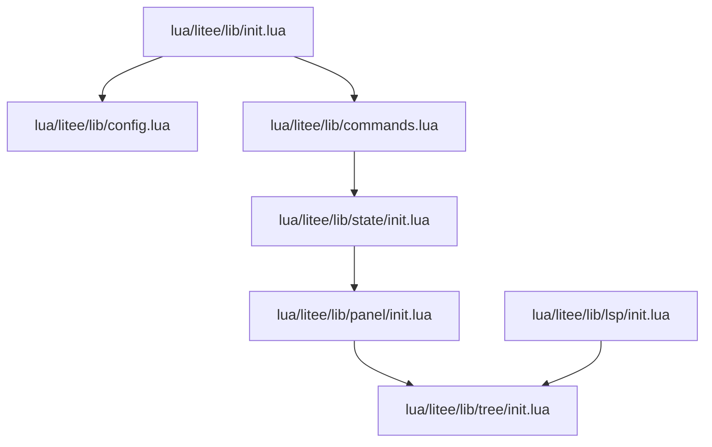

# ldelossa/litee.nvim

> Lua library for building IDE-style interfaces in Neovim, the foundation of official plugins.

## The problem
Neovim plugins that display trees (calls, symbols, files) each rebuild their own panel, with inconsistent behavior.

## What it actually does
Provides shared building blocks: configuration, state, panel, tree (`tree/node`) and LSP requests. The separate plugins Calltree, Symboltree, Filetree and Bookmarks build on it, analogous to VSCode features.

## How it is wired


## Trying it
```bash
# Aucune commande shell. Configuration Lua documentée :
# require('litee.lib').setup({ tree = { icon_set = "codicons" }, panel = { orientation = "left", panel_size = 30 } })
```

## Cost and gotchas
Free. Last push in June 2024 and no declared license: usage and redistribution terms are unclear.

## What it is not
Not a plugin you can use on its own: a library for other plugins.

## Alternatives
No alternative named in the README.

## For you
Ignore: a convenience editor tool, with no license or recent update, unrelated to data or AI.
