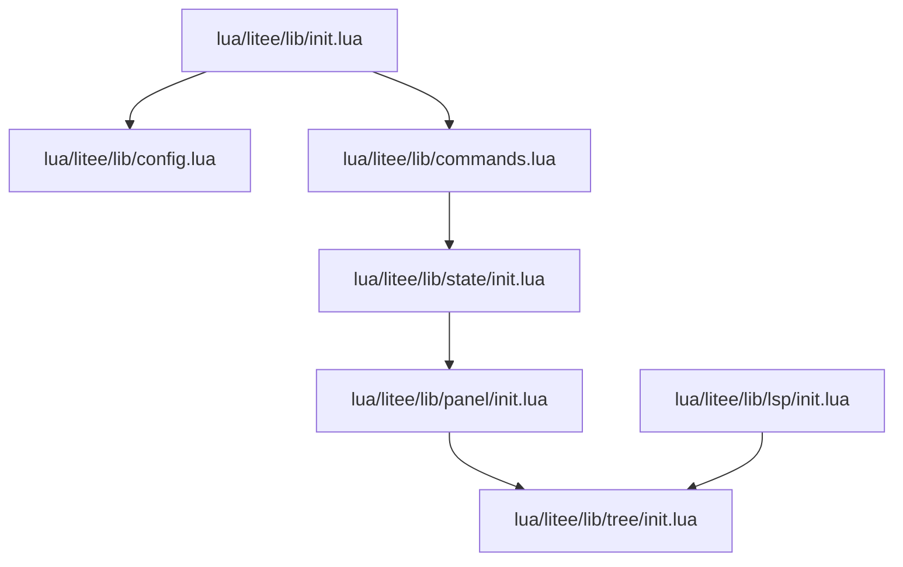

# ldelossa/litee.nvim

> Bibliothèque Lua pour bâtir des interfaces de type IDE dans Neovim, socle de plugins officiels.

## Le problème
Les plugins Neovim qui affichent des arbres (appels, symboles, fichiers) refont chacun leur panneau, avec des comportements incohérents.

## Ce que ça fait vraiment
Fournit des briques communes : configuration, état, panneau, arbre (`tree/node`) et requêtes LSP. S'appuie dessus pour les plugins séparés Calltree, Symboltree, Filetree et Bookmarks, analogues de fonctions de VSCode.

## Comment c'est branché


## Essayer
```bash
# Aucune commande shell. Configuration Lua documentée :
# require('litee.lib').setup({ tree = { icon_set = "codicons" }, panel = { orientation = "left", panel_size = 30 } })
```

## Coût et pièges
Gratuit. Dernier push en juin 2024 et aucune licence déclarée : l'usage et la redistribution ne sont pas clairs.

## Ce que ce n'est pas
Pas un plugin utilisable seul : une bibliothèque pour d'autres plugins.

## Alternatives
Aucune alternative nommée dans le README.

## Pour toi
Ignorer : outil d'éditeur de confort, sans licence ni mise à jour récente, sans rapport avec la data ou l'IA.

