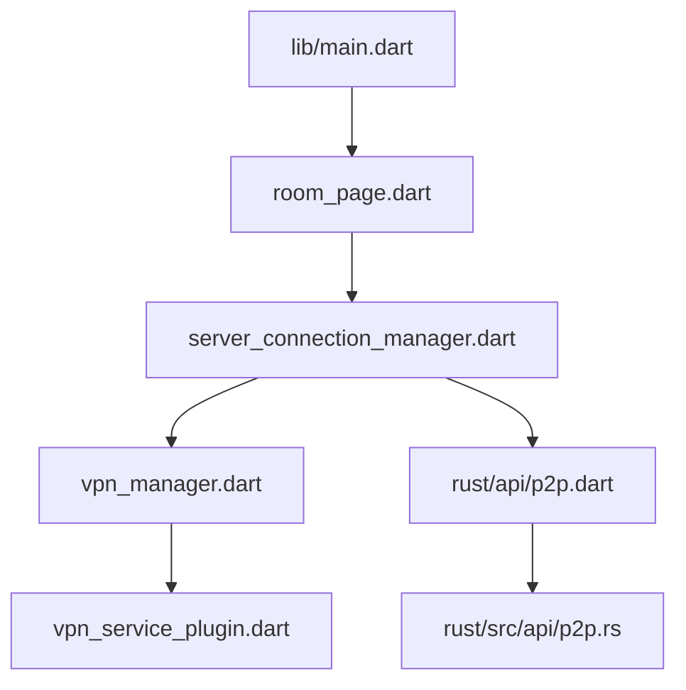

# ldoubil/astral

> Cross-platform networking app for creating peer-to-peer virtual private networks, based on EasyTier.

## The problem
Linking remote machines in a private network requires configuring VPN, relays and firewalls.

## What it actually does
Flutter interface on top of a Rust engine (EasyTier, WireGuard). Management of rooms, servers, users, network settings and the Magic Wall firewall. A native VPN plugin and flutter_rust_bridge connect the Dart to the Rust. Windows, macOS, Linux, Android, iOS. README in Chinese, English for the interface strings.

## How it is wired


## Trying it
```bash
# Aucune commande dans le README : voir la documentation du projet (astral.fan).
```

## Cost and gotchas
Free for non-commercial use only: PolyForm Noncommercial 1.0.0 licence, not automatically recognised by GitHub. Renaming the software is forbidden.

## What it is not
Not free software in the usual sense: commercial use is forbidden. Not a data tool.

## Alternatives
No alternative named in the README (it is built on EasyTier).

## For you
Ignore: peer-to-peer VPN unrelated to your field, and a non-commercial licence incompatible with professional use.
