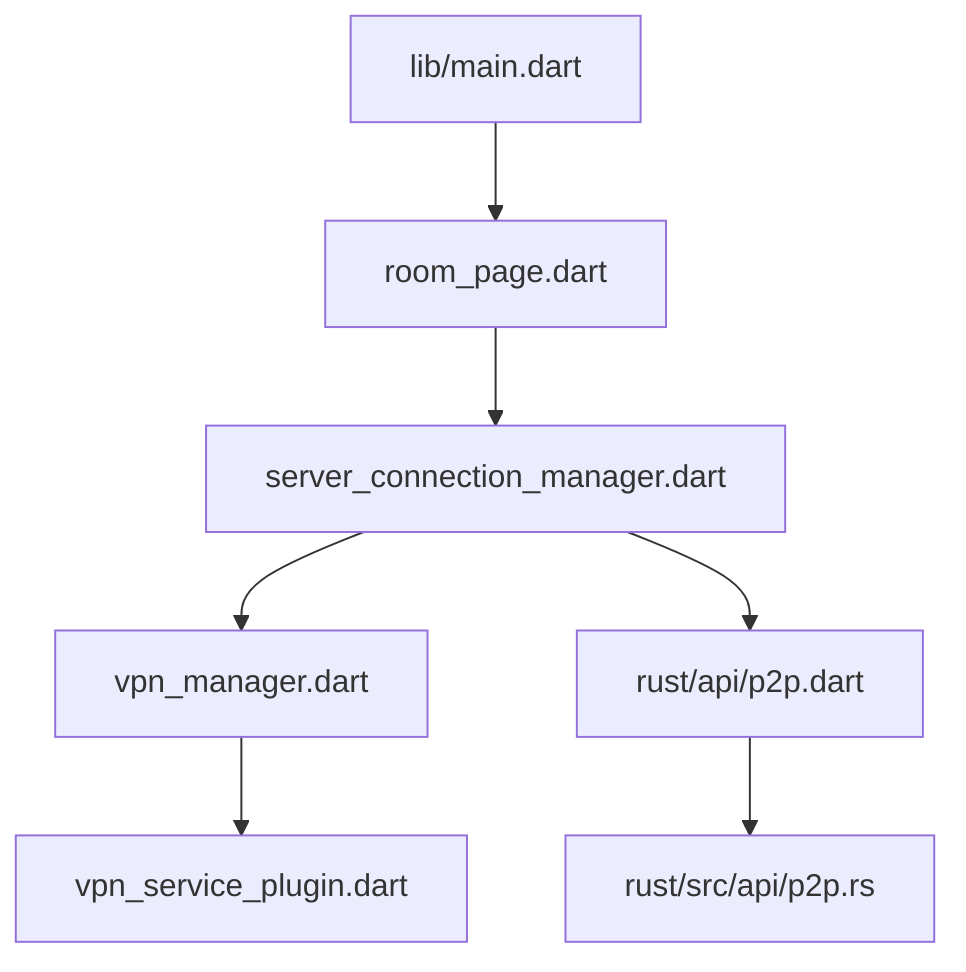

# ldoubil/astral

> Application réseau multiplateforme pour créer des réseaux privés virtuels pair à pair, basée sur EasyTier.

## Le problème
Relier des machines éloignées dans un réseau privé demande de configurer VPN, relais et pare-feu.

## Ce que ça fait vraiment
Interface Flutter au-dessus d'un moteur Rust (EasyTier, WireGuard). Gestion de salons, de serveurs, d'utilisateurs, paramètres réseau et pare-feu Magic Wall. Un plugin VPN natif et flutter_rust_bridge relient le Dart au Rust. Windows, macOS, Linux, Android, iOS. README en chinois, anglais pour les chaînes de l'interface.

## Comment c'est branché


## Essayer
```bash
# Aucune commande dans le README : voir la documentation du projet (astral.fan).
```

## Coût et pièges
Gratuit pour un usage non commercial seulement : licence PolyForm Noncommercial 1.0.0, non reconnue automatiquement par GitHub. Interdit de renommer le logiciel.

## Ce que ce n'est pas
Pas un logiciel libre au sens usuel : usage commercial interdit. Pas un outil data.

## Alternatives
Aucune alternative nommée dans le README (il repose sur EasyTier).

## Pour toi
À ignorer : VPN pair à pair sans lien avec ton métier, et licence non commerciale incompatible avec un usage pro.

