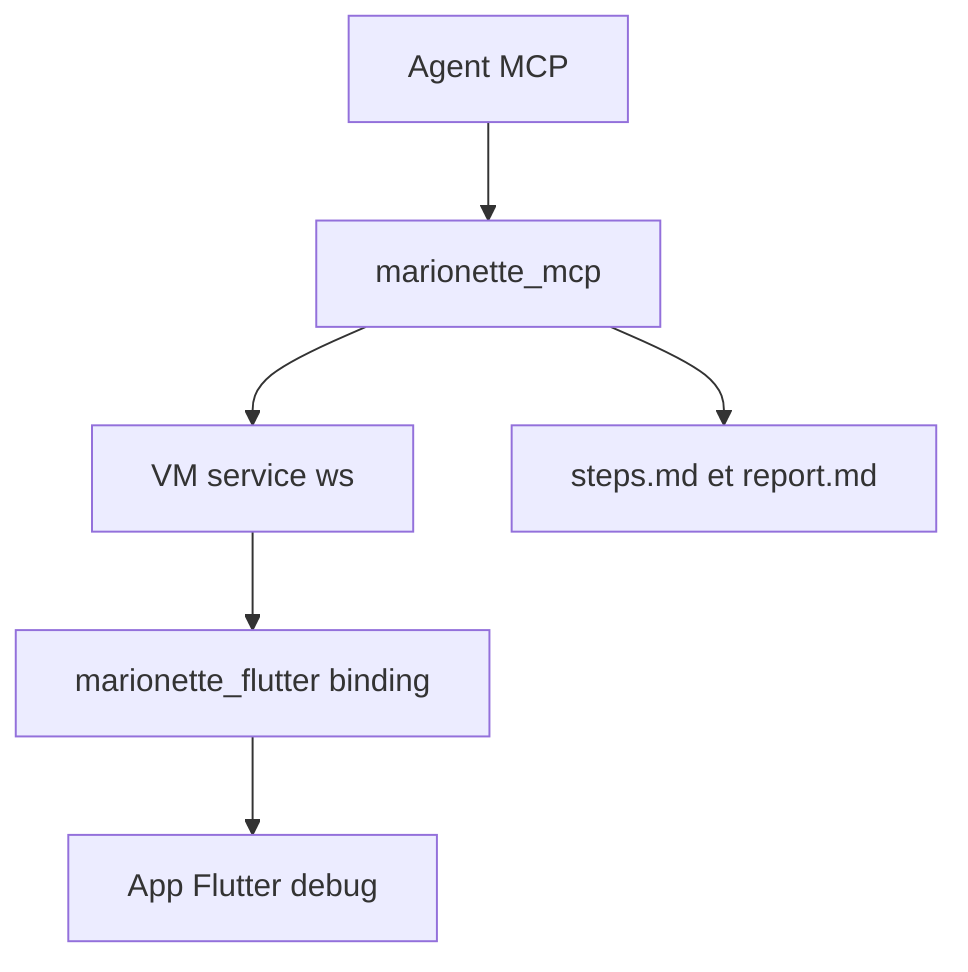

# leancodepl/marionette_mcp

> MCP server that lets an agent see, touch and test a Flutter app in debug mode.

## The problem
A coding agent cannot see the screen of a running Flutter app. It can neither test nor verify it.

## What it actually does
A `marionette_flutter` package is added to the app in debug. The `marionette_mcp` MCP server (or the `marionette` CLI) connects to the VM service URI. The agent reads interactive elements, takes screenshots, taps, scrolls, reads logs, hot reloads and writes a report (`steps.md`, `report.md`). Three agent skills are provided.

## How it is wired
Simplified diagram based on the sheet, no diagram supplied.



## Trying it
```bash
flutter pub add marionette_flutter
dart pub global activate marionette_mcp
claude mcp add --transport stdio marionette -- marionette_mcp
dart pub global activate marionette_cli
```

## Cost and gotchas
Free. Requires the Flutter and Dart environment and an app in debug. A custom design system needs a configuration step, otherwise the agent does not see the buttons.

## What it is not
It is not a tool for production debugging or for other frameworks. The agent does not replace a test suite: the skills help convert a run into Patrol tests.

## Alternatives
- Playwright MCP: the same idea for the web, cited as a reference.
- Patrol: Flutter testing framework from the same publisher.

## For you
Watch: relevant only if you do Flutter, but a good model of an agent-driven MCP testing tool.
