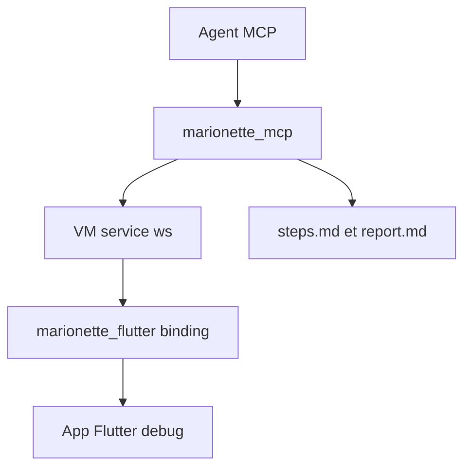

# leancodepl/marionette_mcp

> Serveur MCP qui laisse un agent voir, toucher et tester une application Flutter en mode debug.

## Le problème
Un agent de code ne voit pas l'écran d'une application Flutter en cours d'exécution. Il ne peut ni la tester ni la vérifier.

## Ce que ça fait vraiment
Un paquet `marionette_flutter` s'ajoute à l'application en debug. Le serveur MCP `marionette_mcp` (ou la CLI `marionette`) se connecte à l'URI du service VM. L'agent lit les éléments interactifs, prend des captures, tape, fait défiler, lit les logs, recharge à chaud et écrit un rapport (`steps.md`, `report.md`). Trois skills d'agent sont fournis.

## Comment c'est branché
Schéma simplifié d'après la fiche, sans diagramme fourni.



## Essayer
```bash
flutter pub add marionette_flutter
dart pub global activate marionette_mcp
claude mcp add --transport stdio marionette -- marionette_mcp
dart pub global activate marionette_cli
```

## Coût et pièges
Gratuit. Il faut l'environnement Flutter et Dart et une application en debug. Un système de design personnalisé exige une étape de configuration, sinon l'agent ne voit pas les boutons.

## Ce que ce n'est pas
Ce n'est pas un outil pour le debug en production ni pour d'autres frameworks. L'agent ne remplace pas une suite de tests : les skills aident à convertir une exécution en tests Patrol.

## Alternatives
- Playwright MCP : même idée pour le web, cité comme référence.
- Patrol : framework de test Flutter du même éditeur.

## Pour toi
À surveiller : pertinent seulement si tu fais du Flutter, mais c'est un bon modèle d'outil MCP de test piloté par agent.

