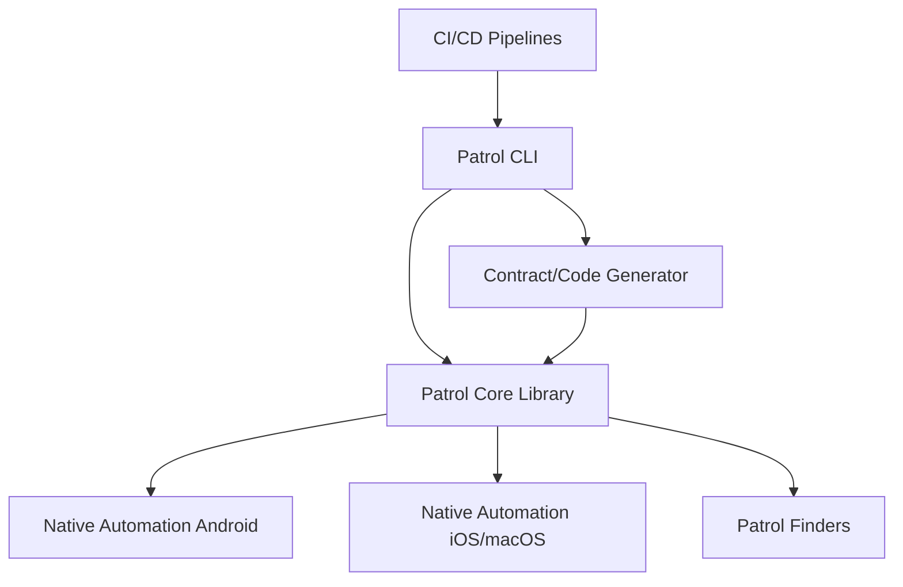

# leancodepl/patrol

> E2E testing framework for Flutter apps, with access to native system features, for mobile teams.

## The problem
Flutter's integration_test package does not touch the OS: it is impossible to test permissions, notifications or login via WebView.

## What it actually does
Provides `patrolTest` and short finders (`$(#button).tap()`), plus native automation on Android, iOS and macOS (permissions, wifi, dark mode, notifications). A CLI runs the tests and enables Hot Restart. A contract generator keeps Dart and native code in sync.

## How it is wired


## Trying it
```bash
dart pub global deactivate patrol_cli
cd packages/patrol_cli
flutter pub global activate -s path .
```
These commands are for developing the CLI; the user installation points to the online documentation.

## Cost and gotchas
Free. You need a Flutter project and emulators or devices. LeanCode sells consulting and training around it.

## What it is not
Not a generic web testing tool nor a tool for non-Flutter apps. Widget tests stay on `flutter test`. The CLI is mandatory for native automation.

## Alternatives
- integration_test (Flutter): provided by default, but no native interaction.
- patrol_finders: finders only, without native automation.

## For you
Keep an eye on it: only useful if you test Flutter apps, outside the usual data / AI / MLOps scope.
