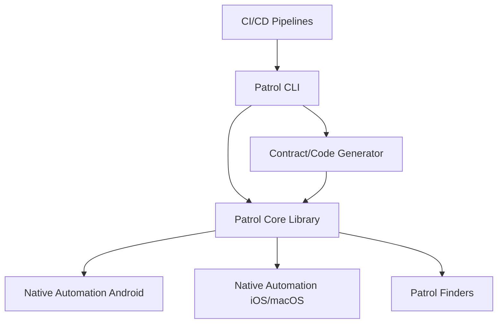

# leancodepl/patrol

> Framework de tests E2E pour applications Flutter, avec accès aux fonctions natives du système, pour équipes mobiles.

## Le problème
Le paquet integration_test de Flutter ne touche pas à l'OS : impossible de tester permissions, notifications ou connexion via WebView.

## Ce que ça fait vraiment
Fournit `patrolTest` et des finders courts (`$(#bouton).tap()`), plus une automatisation native Android, iOS et macOS (permissions, wifi, mode sombre, notifications). Une CLI lance les tests et permet le Hot Restart. Un générateur de contrats synchronise Dart et le code natif.

## Comment c'est branché


## Essayer
```bash
dart pub global deactivate patrol_cli
cd packages/patrol_cli
flutter pub global activate -s path .
```
Ces commandes servent au développement de la CLI ; l'installation utilisateur renvoie à la documentation en ligne.

## Coût et pièges
Gratuit. Il faut un projet Flutter et des émulateurs ou appareils. LeanCode vend du conseil et de la formation autour.

## Ce que ce n'est pas
Pas un outil de test web générique ni un outil pour apps non Flutter. Les tests de widgets restent sur `flutter test`. La CLI est obligatoire pour l'automatisation native.

## Alternatives
- integration_test (Flutter) : fourni d'office, mais sans interaction native.
- patrol_finders : uniquement les finders, sans l'automatisation native.

## Pour toi
À surveiller : utile seulement si tu testes des apps Flutter, hors du périmètre data / IA / MLOps courant.

