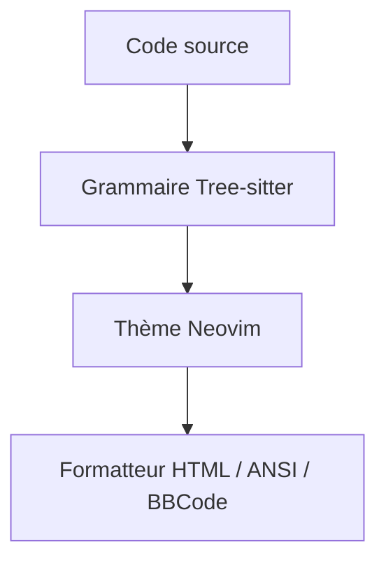

# leandrocp/lumis

> Tree-sitter syntax highlighting with Neovim themes, in CLI, Rust, Elixir, JS and browser.

## The problem
Highlighting code faithfully, with the same themes, across several languages and runtimes.

## What it actually does
Parses code with Tree-sitter grammars (110+ languages), applies a theme extracted from Neovim (200+) and formats to HTML, ANSI or BBCode. Parsers load on demand. Java and Python are community ports.

## How it is wired


## Trying it
```bash
curl -LsSf https://lumis.sh/install.sh | sh
lumis highlight app.js
npm install -g @lumis-sh/cli
```

## Cost and gotchas
Free. The install script goes through `curl | sh`. In JS, each language is a package to install.

## What it is not
Not an editor or a linter: only code formatting.

## Alternatives
No alternative named in the README.

## For you
Worth watching: useful for rendering code in reports or notebooks, with no central stake for a data/AI profile.
