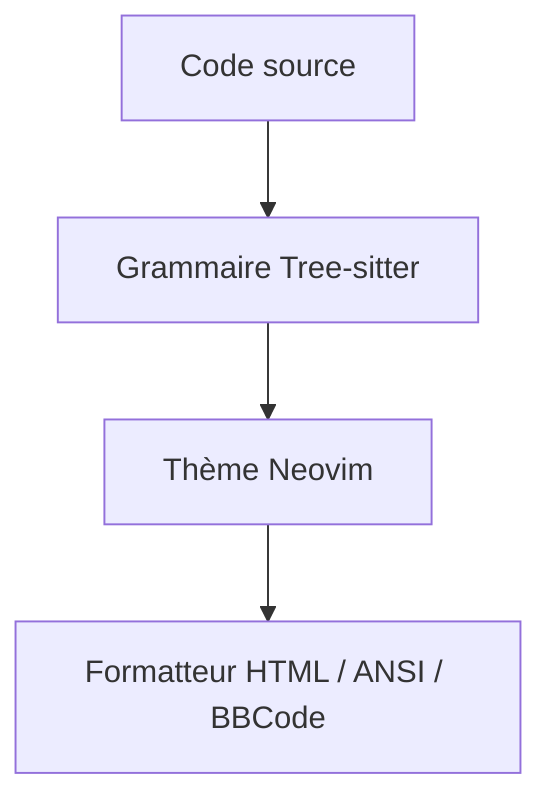

# leandrocp/lumis

> Coloration syntaxique Tree-sitter avec thèmes Neovim, en CLI, Rust, Elixir, JS et navigateur.

## Le problème
Colorer du code de façon fidèle, avec les mêmes thèmes, dans plusieurs langages et runtimes.

## Ce que ça fait vraiment
Analyse le code avec des grammaires Tree-sitter (110+ langages), applique un thème extrait de Neovim (200+) et formate en HTML, ANSI ou BBCode. Les parsers se chargent à la demande. Java et Python sont des ports communautaires.

## Comment c'est branché


## Essayer
```bash
curl -LsSf https://lumis.sh/install.sh | sh
lumis highlight app.js
npm install -g @lumis-sh/cli
```

## Coût et pièges
Gratuit. Le script d'installation passe par `curl | sh`. En JS, chaque langage est un paquet à installer.

## Ce que ce n'est pas
Pas un éditeur ni un linter : uniquement de la mise en forme de code.

## Alternatives
Aucune alternative nommée dans le README.

## Pour toi
À surveiller : utile pour rendre du code dans des rapports ou notebooks, sans enjeu central pour un profil data/IA.

