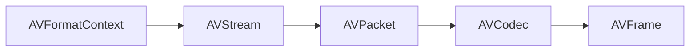

# leandromoreira/ffmpeg-libav-tutorial

> Tutorial for learning video, FFmpeg on the command line and the use of libav in C.

## The problem
Tutorials for using FFmpeg as a library are outdated and leave beginners without an entry point.

## What it actually does
It explains video, audio, codec and container, then the common operations: transcoding, transmuxing, changing bitrate and size, adaptive streaming. The second part codes in C, chapter by chapter: reading info, synchronization, remuxing, transcoding.

## How it is wired


## Trying it
```bash
make fetch_small_bunny_video
make run_hello
ffmpeg -i input.mp4 output.avi
```

## Cost and gotchas
Free, BSD-3-Clause license. The examples run in Docker according to the README. Some demo files weigh about 300 MB. The README provided is truncated after chapter 2.

## What it is not
It is not a library or a tool to install: it is course material, with C even though the idea applies to other languages.

## Alternatives
No alternative named in the README, apart from the original outdated tutorial.

## For you
Keep an eye on it: a good starting point if you handle video streams for datasets or multimedia pipelines.
