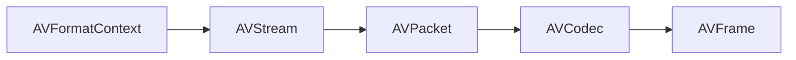

# leandromoreira/ffmpeg-libav-tutorial

> Tutoriel pour apprendre la vidéo, FFmpeg en ligne de commande et l'usage de libav en C.

## Le problème
Les tutoriels pour utiliser FFmpeg comme bibliothèque sont obsolètes et laissent le débutant sans point d'entrée.

## Ce que ça fait vraiment
Il explique vidéo, audio, codec et conteneur, puis les opérations courantes : transcodage, transmuxage, changement de débit et de taille, streaming adaptatif. La seconde partie code en C, chapitre par chapitre : lecture des infos, synchronisation, remuxage, transcodage.

## Comment c'est branché


## Essayer
```bash
make fetch_small_bunny_video
make run_hello
ffmpeg -i input.mp4 output.avi
```

## Coût et pièges
Gratuit, licence BSD-3-Clause. Les exemples s'exécutent dans Docker selon le README. Certains fichiers de démonstration pèsent environ 300 Mo. Le README fourni est tronqué après le chapitre 2.

## Ce que ce n'est pas
Ce n'est pas une bibliothèque ni un outil à installer : c'est un support de cours, avec du C même si l'idée s'applique à d'autres langages.

## Alternatives
Aucune alternative nommée dans le README, hors le tutoriel obsolète d'origine.

## Pour toi
Surveiller : bon point de départ si tu manipules des flux vidéo pour des jeux de données ou des pipelines multimédias.

