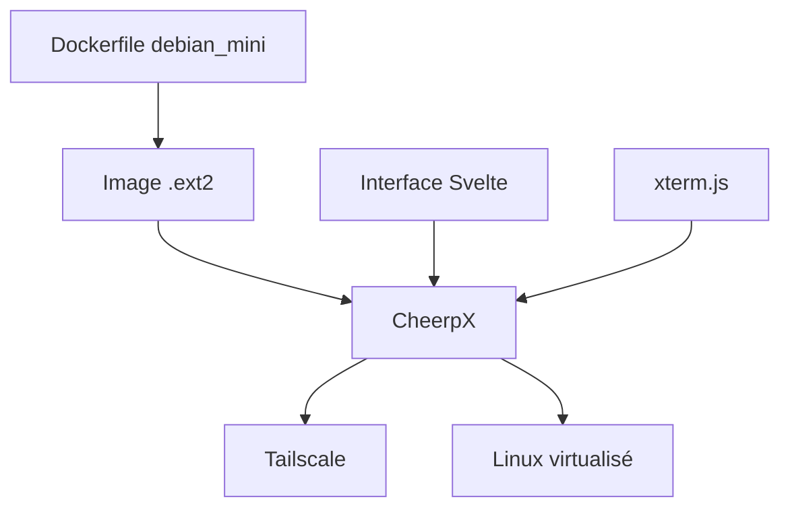

# leaningtech/webvm

> Linux virtual machine that runs entirely in the browser, in WebAssembly, with no server.

## The problem
Offering a disposable, isolated Linux environment (demos, teaching, experiments) without installing or hosting a machine.

## What it actually does
The proprietary CheerpX engine compiles x86 to WebAssembly on the fly, emulates Linux system calls and provides a block-based file system, which runs an unmodified Debian (or Alpine/Xorg/i3) in the tab. xterm.js terminal, networking via Tailscale (or Headscale). You can build your own `.ext2` image from a Dockerfile and deploy it on GitHub Pages. A Claude AI integration is offered with your own key, stored in the browser.

## How it is wired


## Trying it
```bash
git clone https://github.com/leaningtech/webvm.git
cd webvm
npm install
npm run build
nginx -p . -c nginx.conf
```

## Cost and gotchas
Free. The `debian_large` image is too big for GitHub Pages. No `ping` (ICMP missing), no `sudo`. The Claude key stays in your browser but is at your expense. CheerpX is a closed third-party component.

## What it is not
Not a sandbox for heavy computing: no GPU and no native performance.

## Alternatives
The README mentions Mini.WebVM (variant built from a Dockerfile) and the alpine-image for the desktop.

## For you
Worth watching: useful for demos or Python teaching with no installation, not for model training.
