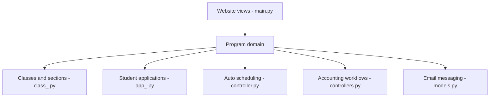

# learning-unlimited/ESP-Website

> Django site for organizing the logistics of short educational programs, by the Splash and Learning Unlimited community.

## The problem
Organizing a large-scale educational event (registrations, classes, rooms, schedule, payments) without spreadsheets or scattered tools.

## What it actually does
Django application that manages programs, classes and sections, student applications, resources, automatic scheduling, accounting, surveys, emails, forms and configurable themes. The domain models carry the state (program, class, user, resource). The repository has existed since 2011 and remains active (last push 2026-09-18, 549 open issues).

## How it is wired


## Trying it
```bash
git clone https://github.com/learning-unlimited/ESP-Website.git devsite
cd devsite
docker compose up --build
```
Then open http://localhost:8000.

## Cost and gotchas
Free, requires Docker. Detailed documentation is in `docs/` and the wiki; the README says nothing about production.

## What it is not
Not an LMS or an online course platform: it is event logistics. Nothing related to data or AI.

## Alternatives
No alternative named in the README.

## For you
Ignore: topic far from the data/AI/MLOps profile, but a useful sheet if you organize an educational event.
