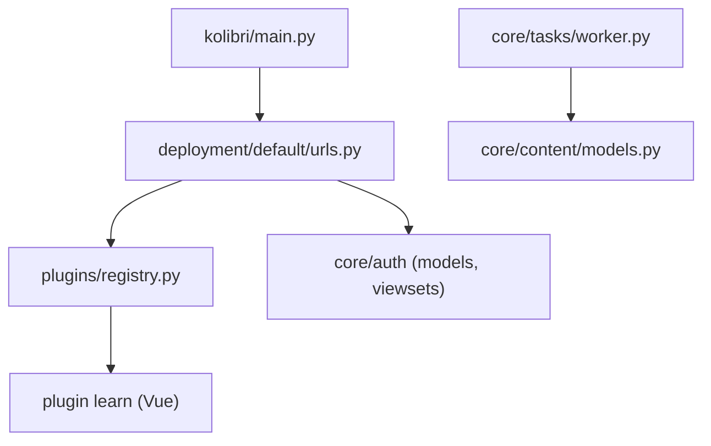

# learningequality/kolibri

> Offline learning platform, a local Django server, for schools without reliable Internet access.

## The problem
Schools without a reliable connection cannot reach online educational resources.

## What it actually does
A local Python/Django server with Vue plugins: learner, coach, sign-in. It manages content channels, lessons, quizzes, progress tracking, synchronization between devices and peer discovery. EPUB, PDF, HTML5 and QTI viewers run sandboxed. Delivered in the browser, on Android, desktop, Debian and Raspberry Pi.

## How it is wired

## Trying it
No command in the README (the repository is aimed at contributors). The download and the guide are on the Learning Equality website.

## Cost and gotchas
Free. Python is required on the server side, and content is downloaded through channels. 581 open issues.

## What it is not
Not an online LMS: it is designed to work without Internet. This repository is the development one, not the usage guide.

## Alternatives
No alternative named in the README.

## For you
Ignore: an educational platform with no direct link to data / AI / MLOps work, but solid and backed by an organization.
