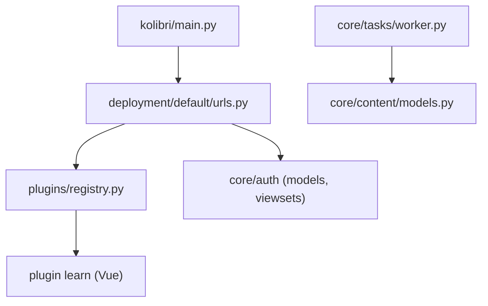

# learningequality/kolibri

> Plateforme d'apprentissage hors ligne, serveur local Django, pour écoles sans accès Internet fiable.

## Le problème
Les écoles sans connexion fiable n'accèdent pas aux ressources éducatives en ligne.

## Ce que ça fait vraiment
Un serveur Python/Django local avec plugins Vue : apprenant, coach, connexion. Il gère canaux de contenu, leçons, quiz, suivi de progression, synchronisation entre appareils et découverte de pairs. Visionneuses EPUB, PDF, HTML5 et QTI isolées dans un bac à sable. Livré en navigateur, Android, bureau, Debian et Raspberry Pi.

## Comment c'est branché

## Essayer
Aucune commande dans le README (dépôt destiné aux contributeurs). Le téléchargement et le guide sont sur le site de Learning Equality.

## Coût et pièges
Gratuit. Il faut Python côté serveur, et les contenus se téléchargent par canaux. 581 tickets ouverts.

## Ce que ce n'est pas
Pas un LMS en ligne : il est pensé pour fonctionner sans Internet. Ce dépôt est celui du développement, pas du guide d'usage.

## Alternatives
Aucune alternative nommée dans le README.

## Pour toi
Ignorer : plateforme éducative sans lien direct avec un travail data / IA / MLOps, mais solide et soutenue par une organisation.

