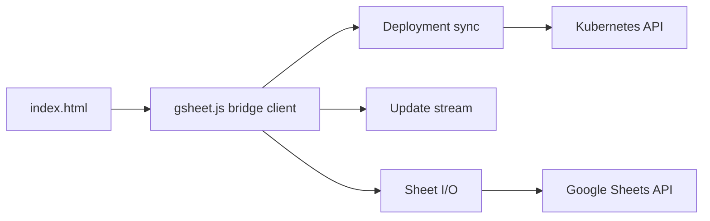

# learnk8s/xlskubectl

> Experimental bridge that displays Kubernetes deployments in Google Sheets and lets you change their replica count.

## The problem
No real need: the project is presented as a joke ("they wondered whether they could, not whether they should").

## What it actually does
A web page served by `kubectl proxy` loads the deployments, syncs them into a Google Sheets sheet, and follows updates through the Kubernetes API stream; changing the replica count in the sheet scales the deployment. All the client code fits in `gsheet.js`.

## How it is wired


## Trying it
```bash
kubectl proxy --www=.
# puis ouvrir la page servie sur 127.0.0.1:8001 et suivre l'assistant d'identifiants Google
```

## Cost and gotchas
Free, but it creates Google credentials and exposes the kubectl proxy. No license declared; last push in September 2022.

## What it is not
Not a production tool; the README says so itself, ironically.

## Alternatives
No alternative named in the README.

## For you
Ignore: a curiosity unmaintained since 2022 and without a license, risky to connect to a cluster.
