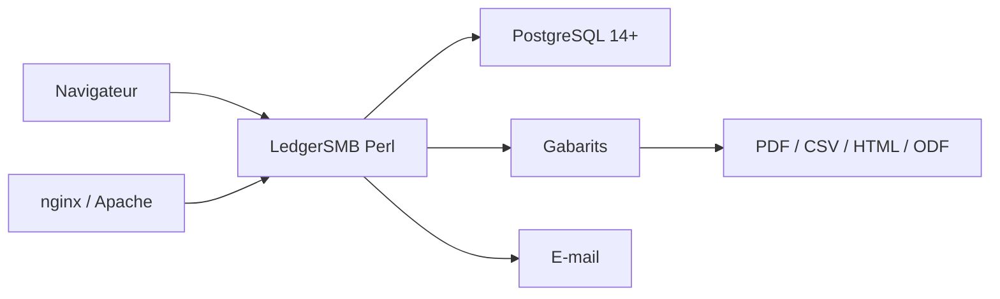

# ledgersmb/LedgerSMB

> Web-based double-entry accounting and ERP application for small and medium businesses.

## The problem
A small business wants self-hosted accounting, invoicing and inventory, without proprietary software.

## What it actually does
- Double-entry accounting in the browser: quotes, orders, invoices, projects, timesheets, inventory, shipments.
- Sending orders and invoices by e-mail with a PDF attached.
- Data in PostgreSQL; customizable templates, PDF, CSV, HTML, ODF outputs.
- Runs on Perl 5.38+ and PostgreSQL 14+; a web server is required in production.

## How it is wired


## Trying it
```bash
wget https://raw.githubusercontent.com/ledgersmb/ledgersmb-docker/1.13/docker-compose.yml
docker-compose up -d
# puis http://localhost:5762/setup.pl et http://localhost:5762/login.pl
```

## Cost and gotchas
Free, requires Docker and docker-compose. The README's Docker setup is not suited to production (no secure connection, no web server). Safari over HTTP is not supported.

## What it is not
Not a data / AI tool. The README describes version 1.14 in development; 1.13 is the stable one. License present but not identified by GitHub.

## Alternatives
No alternative named in the README.

## For you
Ignore for a data / AI / MLOps profile: it is an accounting ERP unrelated to your field, to keep only if you are looking to self-host accounting.
