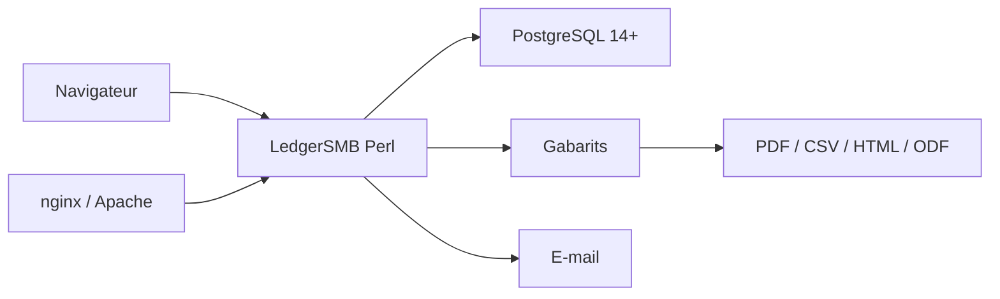

# ledgersmb/LedgerSMB

> Application web de comptabilité en partie double et ERP pour petites et moyennes entreprises.

## Le problème
Une PME veut une comptabilité, de la facturation et des stocks auto-hébergés, sans logiciel propriétaire.

## Ce que ça fait vraiment
- Comptabilité en partie double dans le navigateur : devis, commandes, factures, projets, feuilles de temps, stocks, expéditions.
- Envoi des commandes et factures par e-mail avec PDF joint.
- Données dans PostgreSQL ; gabarits personnalisables, sorties PDF, CSV, HTML, ODF.
- Tourne sur Perl 5.38+ et PostgreSQL 14+ ; serveur web requis en production.

## Comment c'est branché


## Essayer
```bash
wget https://raw.githubusercontent.com/ledgersmb/ledgersmb-docker/1.13/docker-compose.yml
docker-compose up -d
# puis http://localhost:5762/setup.pl et http://localhost:5762/login.pl
```

## Coût et pièges
Gratuit, nécessite Docker et docker-compose. Le setup Docker du README n'est pas adapté à la production (pas de connexion sécurisée, pas de serveur web). Safari en HTTP non supporté.

## Ce que ce n'est pas
Pas un outil data / IA. Le README décrit la version 1.14 en développement ; la 1.13 est la stable. Licence présente mais non identifiée par GitHub.

## Alternatives
Aucune alternative nommée dans le README.

## Pour toi
Ignorer pour un profil data / IA / MLOps : c'est un ERP comptable sans lien avec ton domaine, à garder seulement si tu cherches à auto-héberger une comptabilité.

