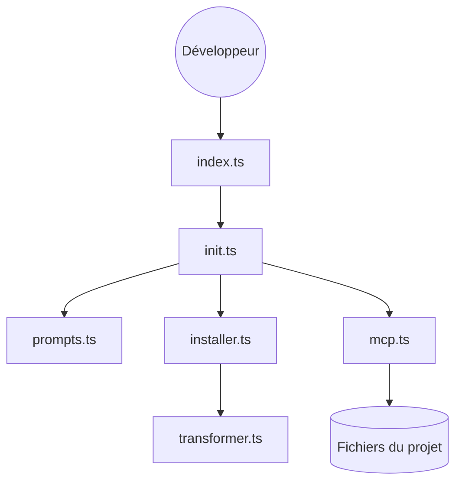

# lee-to/ai-factory

> CLI that installs skills, MCP servers and configuration for coding agents, with a plan-driven development flow.

## The problem
Setting up context, prompts and workflows for each coding agent takes time and differs from one agent to the next.

## What it actually does
`ai-factory init` asks which agent you use, installs the matching skills, writes the project configuration and wires up the MCP servers. The `aif-*` skills cover explore, plan, implement, fix, CI and docs. Files are adapted to each agent's format. Extensions add commands and agents.

## How it is wired


## Trying it
```bash
npm install -g ai-factory
ai-factory init
ai-factory init --agents claude,codex --mcp playwright,github
npx skills add lee-to/ai-factory --skill '*'
```

## Cost and gotchas
Free, but your coding agents remain paid. No license declared: usage and redistribution are legally unclear.

## What it is not
Not an agent: it prepares the environment of existing agents. How the skills run internally is not established by the code analyzed.

## Alternatives
- HLV: cited by the README if AI Factory seems too simple.
- skills.sh: a skills marketplace, for installing only the skills.

## For you
Worth watching: handy for standardizing skills and MCP across agents, but the lack of a license blocks serious team use.
