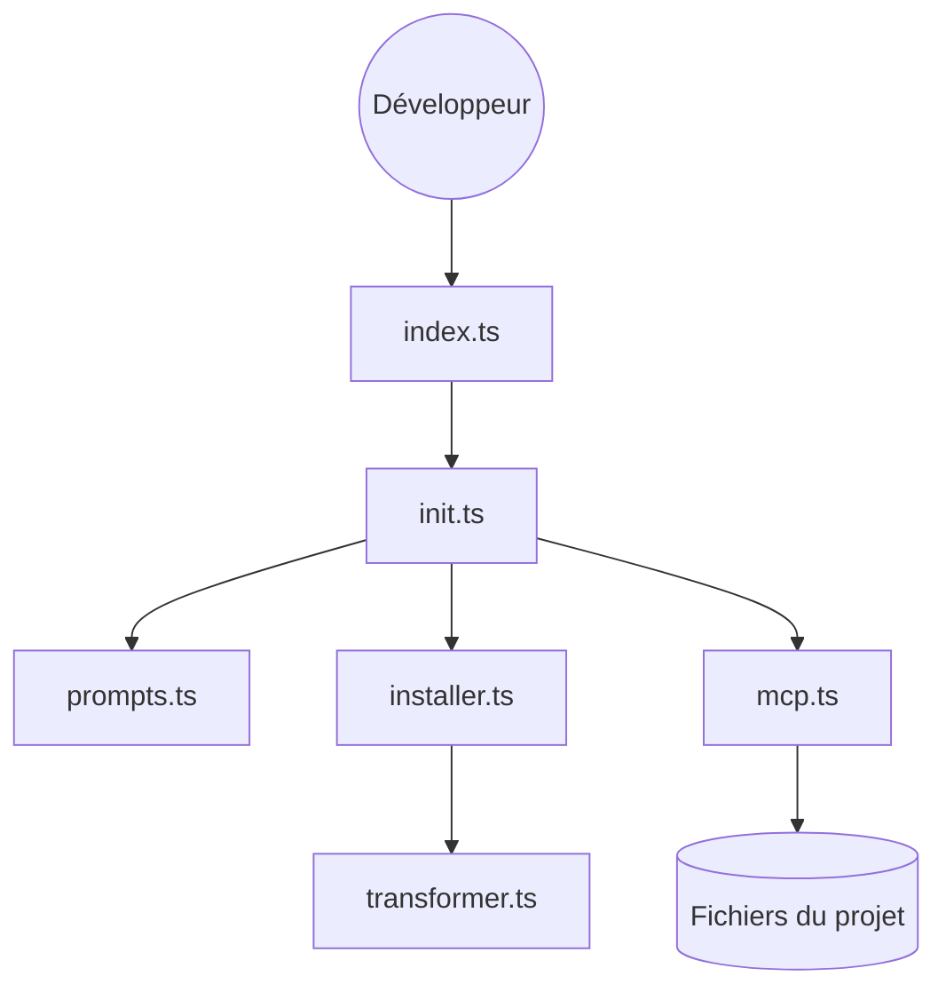

# lee-to/ai-factory

> CLI qui installe skills, serveurs MCP et configuration pour agents de code, avec un flux de développement guidé par plan.

## Le problème
Configurer contexte, prompts et workflows pour chaque agent de code prend du temps et diffère d'un agent à l'autre.

## Ce que ça fait vraiment
`ai-factory init` demande l'agent utilisé, installe les skills correspondants, écrit la configuration du projet et branche les serveurs MCP. Les skills `aif-*` couvrent explorer, planifier, implémenter, corriger, CI et docs. Les fichiers sont adaptés au format de chaque agent. Des extensions ajoutent commandes et agents.

## Comment c'est branché


## Essayer
```bash
npm install -g ai-factory
ai-factory init
ai-factory init --agents claude,codex --mcp playwright,github
npx skills add lee-to/ai-factory --skill '*'
```

## Coût et pièges
Gratuit, mais tes agents de code restent payants. Aucune licence déclarée : usage et redistribution juridiquement flous.

## Ce que ce n'est pas
Pas un agent : il prépare l'environnement d'agents existants. L'exécution interne des skills n'est pas établie par le code analysé.

## Alternatives
- HLV : cité par le README si AI Factory paraît trop simple.
- skills.sh : place de marché de skills, pour n'installer que les skills.

## Pour toi
À surveiller : pratique pour standardiser skills et MCP entre agents, mais l'absence de licence bloque un usage sérieux en équipe.

