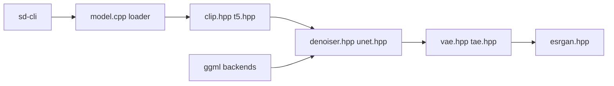

# leejet/stable-diffusion.cpp

> Inference of diffusion models (SD, Flux, Wan…) in pure C/C++, on ggml, with no heavy dependencies.

## The problem
Running Stable Diffusion or Flux without a Python/PyTorch stack, including on CPU, Vulkan or Metal.

## What it actually does
An `sd-cli` executable loads weights (.ckpt, .safetensors, .gguf), runs text encoding (CLIP, T5), the sampling loop (Euler, DPM++, LCM…), VAE/TAESD decoding, ESRGAN upscaling. Supports LoRA, ControlNet, PhotoMaker, GGUF quantization, video models, and the CPU, CUDA, Vulkan, Metal, OpenCL, SYCL backends.

## How it is wired


## Trying it
```bash
curl -L -O https://huggingface.co/stable-diffusion-v1-5/stable-diffusion-v1-5/resolve/main/v1-5-pruned-emaonly.safetensors
./bin/sd-cli -m ../models/v1-5-pruned-emaonly.safetensors -p "a lovely cat"
```

## Cost and gotchas
Free; model weights to download (several GB), VRAM useful. API and options change frequently (README warning). 256 open issues.

## What it is not
Not a creation interface: you need a front end (UI list in the README). No training.

## Alternatives
The README compares itself to llama.cpp for philosophy; Python bindings (stable-diffusion-cpp-python) and UIs (LocalAI, KoboldCpp) are cited.

## For you
Adopt to deploy lightweight, portable image inference, with the Python bindings to integrate it.
