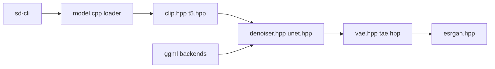

# leejet/stable-diffusion.cpp

> Inférence de modèles de diffusion (SD, Flux, Wan…) en C/C++ pur, sur ggml, sans dépendances lourdes.

## Le problème
Faire tourner Stable Diffusion ou Flux sans pile Python/PyTorch, y compris sur CPU, Vulkan ou Metal.

## Ce que ça fait vraiment
Un exécutable `sd-cli` charge des poids (.ckpt, .safetensors, .gguf), exécute encodage de texte (CLIP, T5), boucle d'échantillonnage (Euler, DPM++, LCM…), décodage VAE/TAESD, upscaling ESRGAN. Supporte LoRA, ControlNet, PhotoMaker, quantification GGUF, des modèles vidéo, et les backends CPU, CUDA, Vulkan, Metal, OpenCL, SYCL.

## Comment c'est branché


## Essayer
```bash
curl -L -O https://huggingface.co/stable-diffusion-v1-5/stable-diffusion-v1-5/resolve/main/v1-5-pruned-emaonly.safetensors
./bin/sd-cli -m ../models/v1-5-pruned-emaonly.safetensors -p "a lovely cat"
```

## Coût et pièges
Gratuit ; poids de modèles à télécharger (plusieurs Go), VRAM utile. API et options changent fréquemment (avertissement du README). 256 issues ouvertes.

## Ce que ce n'est pas
Pas une interface de création : il faut un front (liste d'UI dans le README). Pas d'entraînement.

## Alternatives
Le README se compare à llama.cpp pour la philosophie ; bindings Python (stable-diffusion-cpp-python) et UIs (LocalAI, KoboldCpp) cités.

## Pour toi
À adopter pour déployer de l'inférence d'images légère et portable, avec les bindings Python pour l'intégrer.

