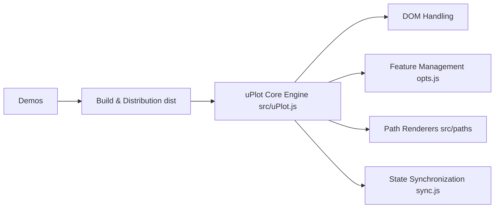

# leeoniya/uPlot

> JavaScript Canvas 2D library (~50 KB) for very fast time-series charts.

## The problem
Typical web charting libraries become slow and resource-hungry with hundreds of thousands of points or streaming data.

## What it actually does
Draws lines, areas, OHLC and bars in Canvas 2D; 166,650 points in 25 ms cold start, as claimed.
Multiple Y axes, log scales, zoom, live legend, IANA time zones, missing data, synchronized cursors.
Pluggable path renderers (linear, spline, stepped, bars); hooks and plugins API.
Comparative benchmark published against Chart.js, ECharts, Plotly, Highcharts…

## How it is wired

## Trying it
No installation command documented in the README (see `/docs/README.md` and `/demos`).

## Cost and gotchas
Free, MIT. Docs are "work in progress": the API is read in `dist/uPlot.d.ts` and the demos.

## What it is not
No aggregation or statistics, no animations, no stacked series, no native pan. Beyond ~100k visible points, switch to WebGL.

## Alternatives
- danchitnis/webgl-plot, huww98/TimeChart, epezent/implot: WebGL/WebGPU for very large volumes.
- uDSV: to parse the data upstream.

## For you
Worth watching: excellent for a training-metrics or real-time monitoring dashboard on the front end; a Python wrapper also exists.
