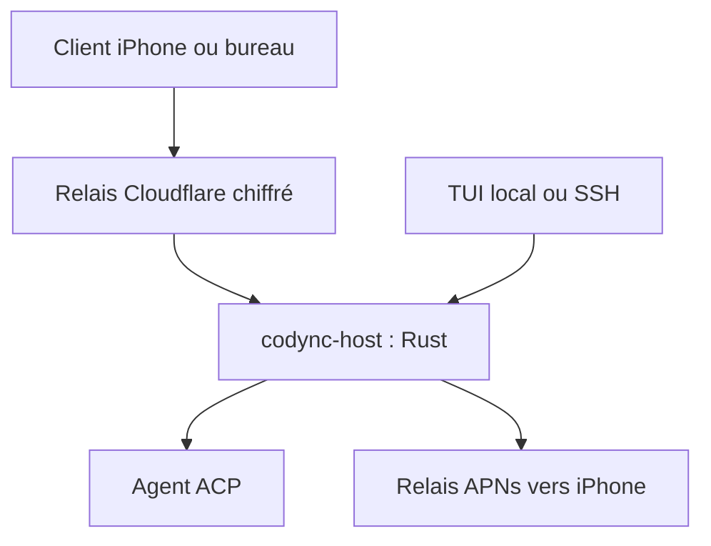

# leepokai/Codync

> Control the coding agents installed on your computer from your iPhone or a terminal, as named bots.

## The problem
Finding the right agent session from a phone is slow, and each agent has its own interface.

## What it actually does
A Rust daemon (`codync-host`) drives Claude Code, Codex, Cursor, Gemini and about forty other agents through the ACP protocol. Each bot has a persistent chat, a group conversation is possible, and the bots ask each other for help. You get approval notifications, remote screen and voice calls. Transcripts are kept in SQLite on your machine.

## How it is wired


## Trying it
```bash
curl -fsSL https://raw.githubusercontent.com/leepokai/Codync/main/packaging/install.sh | sh
brew install --cask leepokai/codync/codync
codync-host install
codync-host pair
```

## Cost and gotchas
Free, but you need an account (Apple, Google or GitHub) and your own agent subscription or key. The Cloudflare relay is hosted by the author. The Windows installer is not signed, and the iPhone app requires iOS 26 or later.

## What it is not
Not a coding agent: it drives other ones. Remote screen does not exist yet on Windows. End-to-end encryption is claimed by the author, not verified here.

## Alternatives
No alternative named in the README, apart from the Grok Bot, Muse and Dots apps it is compared with.

## For you
Worth watching: useful if you delegate a lot to coding agents, but the mandatory account, third-party relay and single maintainer call for caution.
