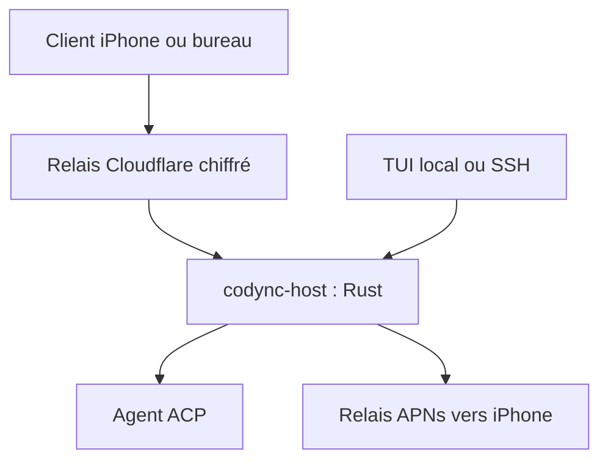

# leepokai/Codync

> Pilote depuis ton iPhone ou un terminal les agents de code installés sur ton ordinateur, comme des bots nommés.

## Le problème
Retrouver la bonne session d'agent depuis un téléphone est lent, et chaque agent a sa propre interface.

## Ce que ça fait vraiment
Un démon Rust (`codync-host`) pilote Claude Code, Codex, Cursor, Gemini et une quarantaine d'autres agents via le protocole ACP. Chaque bot a un chat persistant, une conversation de groupe est possible, et les bots se demandent de l'aide entre eux. Tu reçois des notifications d'approbation, écran distant et appels vocaux. Les transcriptions sont gardées en SQLite sur ta machine.

## Comment c'est branché


## Essayer
```bash
curl -fsSL https://raw.githubusercontent.com/leepokai/Codync/main/packaging/install.sh | sh
brew install --cask leepokai/codync/codync
codync-host install
codync-host pair
```

## Coût et pièges
Gratuit, mais il faut un compte (Apple, Google ou GitHub) et ton propre abonnement ou clé d'agent. Le relais Cloudflare est hébergé par l'auteur. L'installateur Windows n'est pas signé, et l'application iPhone demande iOS 26 ou plus.

## Ce que ce n'est pas
Pas un agent de code : il en pilote d'autres. L'écran distant n'existe pas encore sous Windows. Le chiffrement de bout en bout est affirmé par l'auteur, non vérifié ici.

## Alternatives
Aucune alternative nommée dans le README, hormis les apps Grok Bot, Muse et Dots comparées.

## Pour toi
À surveiller : utile si tu délègues beaucoup à des agents de code, mais compte obligatoire, relais tiers et mainteneur unique appellent à la prudence.

