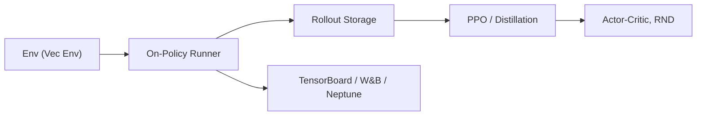

# leggedrobotics/rsl_rl

> Compact GPU reinforcement learning library for robotics (PPO, distillation).

## The problem
Large RL libraries are heavy to modify; robotics researchers want short code to test an idea.

## What it actually does
Implements PPO and student-teacher distillation, with actor-critic (recurrent or not), normalization, RND exploration and symmetry augmentation. Multi-GPU training, tracking with TensorBoard, Weights & Biases or Neptune. Used by Isaac Lab, Legged Gym, mjlab and MuJoCo Playground.

## How it is wired


## Trying it
```bash
pip install rsl-rl-lib
git clone https://github.com/leggedrobotics/rsl_rl
cd rsl_rl
pip install -e .
```

## Cost and gotchas
Free. You need a simulation environment provided elsewhere (Isaac Lab, etc.). A license is present but not identified by GitHub: read it.

## What it is not
Not an environment nor a catalog of algorithms: only on-policy methods; other algorithms exist on branches (mentioned by the diagram).

## Alternatives
Not documented in the README.

## For you
Ignore: a robotics RL building block with no direct use for a data/MLOps profile, unless you go through Isaac Lab or mjlab.
