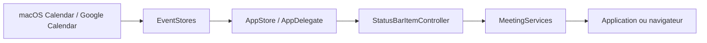

# leits/MeetingBar

> macOS menu bar application that shows the next meeting and lets you join it in one click.

## The problem
Finding the link to the next video call in your calendar wastes a few minutes before each meeting.

## What it actually does
Reads the macOS calendar or Google Calendar, detects meeting links (50+ services: Meet, Zoom, Teams, Webex, Discord), shows the current or next meeting in the menu bar, reminders and full-screen notifications, global shortcut, Raycast, Shortcuts and AppleScript integrations. Written in Swift 6; does not collect personal data according to the README.

## How it is wired


## Trying it
```bash
brew install --cask meetingbar
```

## Cost and gotchas
Free. macOS 12 minimum. Google Calendar goes through an OAuth authentication to be configured in the application.

## What it is not
Not a meeting transcription or recording tool. Not available outside macOS.

## Alternatives
No alternative named in the README.

## For you
Ignore on the data/AI side: a convenience utility restricted to macOS, unrelated to a pipeline.
