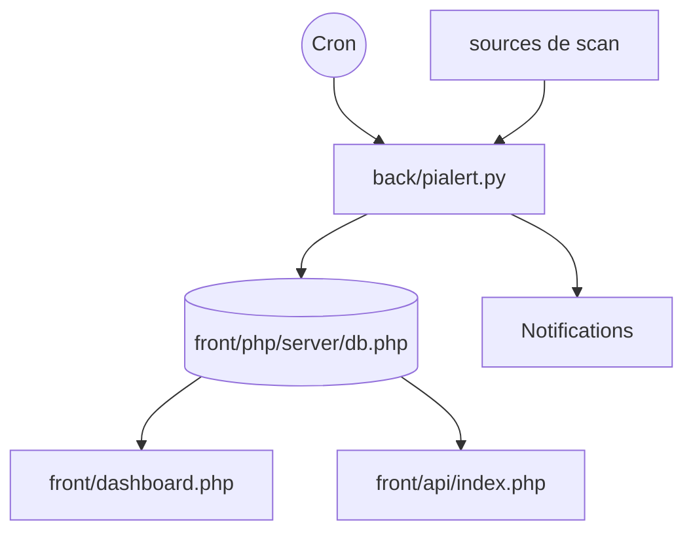

# leiweibau/Pi.Alert

> Local network monitoring that detects unknown devices and services that are down.

## The problem
An intruder device or a service going down on your network goes unnoticed without an alert.

## What it actually does
An engine scheduled by cron (every five minutes) discovers devices via arp-scan, Pi-hole, FRITZ!Box, MikroTik, UniFi, OpenWrt, pfSense, OPNsense or AdGuard Home, monitors hosts by ICMP, web services (status, latency, SSL certificate), records to a database and notifies (email, Pushover, ntfy, Telegram, MQTT). Multilingual web interface and an API for Home Assistant. Can run Nmap and Wake-on-LAN.

## How it is wired


## Trying it
```bash
sudo bash -c "$(wget -qLO - https://github.com/leiweibau/Pi.Alert/raw/main/install/pialert_install.sh)"
sudo bash -c "$(wget -qLO - https://github.com/leiweibau/Pi.Alert/raw/main/install/pialert_update.sh)"
```

## Cost and gotchas
Free. Targets Debian and derivatives, installer run as root from the network. The repository credits the use of ChatGPT and DeepL.

## What it is not
Not an intrusion scanner: it monitors a network you administer. The README describes NetAlertX as a project that became independent, Docker-based.

## Alternatives
NetAlertX (fork that became independent, Docker-based) and the original project pucherot/Pi.Alert, unmaintained.

## For you
Ignore: home network monitoring is useful in a homelab, but unrelated to a data, AI or MLOps path.
