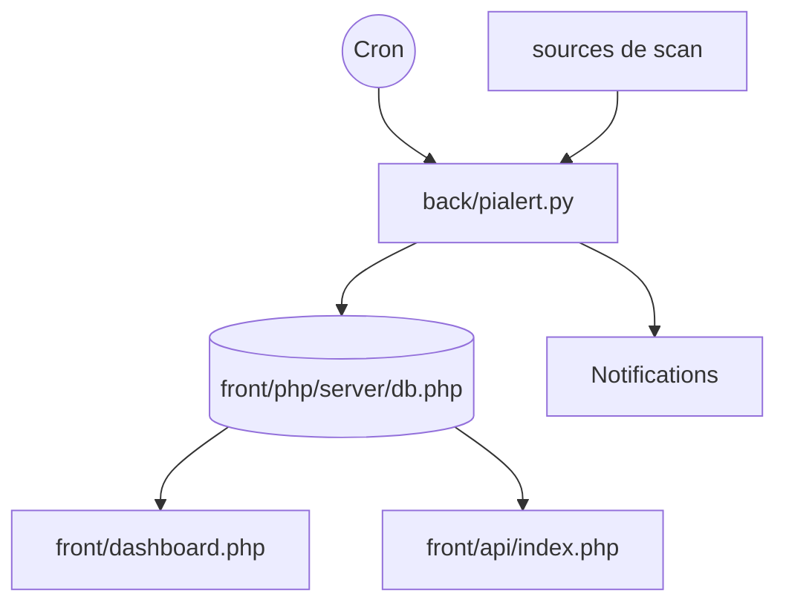

# leiweibau/Pi.Alert

> Surveillance du réseau local qui détecte les appareils inconnus et les services en panne.

## Le problème
Un appareil intrus ou un service qui tombe sur ton réseau passe inaperçu sans alerte.

## Ce que ça fait vraiment
Un moteur planifié par cron (toutes les cinq minutes) découvre les appareils via arp-scan, Pi-hole, FRITZ!Box, MikroTik, UniFi, OpenWrt, pfSense, OPNsense ou AdGuard Home, surveille des hôtes par ICMP, des services web (statut, délai, certificat SSL), enregistre en base et notifie (email, Pushover, ntfy, Telegram, MQTT). Interface web multilingue et API pour Home Assistant. Peut lancer Nmap et Wake-on-LAN.

## Comment c'est branché


## Essayer
```bash
sudo bash -c "$(wget -qLO - https://github.com/leiweibau/Pi.Alert/raw/main/install/pialert_install.sh)"
sudo bash -c "$(wget -qLO - https://github.com/leiweibau/Pi.Alert/raw/main/install/pialert_update.sh)"
```

## Coût et pièges
Gratuit. Cible Debian et dérivés, installateur exécuté en root depuis le réseau. Le dépôt cite l'usage de ChatGPT et DeepL comme crédits.

## Ce que ce n'est pas
Pas un scanner d'intrusion : il surveille un réseau que tu administres. Le README décrit NetAlertX comme projet devenu indépendant, Docker.

## Alternatives
NetAlertX (fork devenu indépendant, basé Docker) et le projet d'origine pucherot/Pi.Alert, non maintenu.

## Pour toi
À ignorer : surveillance de réseau domestique utile en homelab, mais sans lien avec un parcours data, IA ou MLOps.

