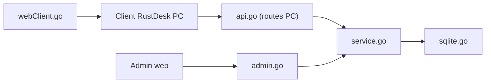

# lejianwen/rustdesk-api

> RustDesk API server in Go with a web administration console and web client to manage your remote access.

## The problem
The base RustDesk server offers no address books, groups, logs or self-hosted user management.

## What it actually does
Implements the PC client routes (login, address book, groups), an administration console (users, devices, connection and transfer logs, server commands) and a web client, with guest link sharing. GitHub, Google, OIDC and LDAP login. SQLite or MySQL database. The README is in Chinese.

## How it is wired


## Trying it
```bash
docker run -d --name rustdesk-api -p 21114:21114 \
    -v /data/rustdesk/api:/app/data \
    -e RUSTDESK_API_RUSTDESK_ID_SERVER=192.168.1.66:21116 \
    -e RUSTDESK_API_RUSTDESK_RELAY_SERVER=192.168.1.66:21117 \
    -e RUSTDESK_API_RUSTDESK_API_SERVER=http://192.168.1.66:21114 \
    -e RUSTDESK_API_RUSTDESK_KEY=<key> \
    lejianwen/rustdesk-api
./apimain reset-admin-pwd <pwd>
```

## Cost and gotchas
Free. The initial administrator is `admin`, with the password shown in the console: change it. Works best paired with the lejianwen/rustdesk-server fork.

## What it is not
Not a relay server: you need a RustDesk server alongside. Last push at the end of September 2025.

## Alternatives
lejianwen/rustdesk-server, the companion server recommended by the README.

## For you
Remote access administration unrelated to data/AI: ignore.
