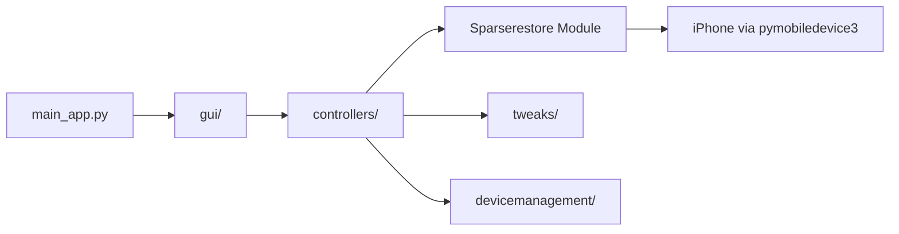

# leminlimez/Nugget

> Desktop tool that modifies hidden iPhone settings through a restore exploit.

## The problem
iOS does not expose certain settings (status bar, daemons, animated wallpaper, internal flags).

## What it actually does
PySide6 interface (and CLI) that, via pymobiledevice3, exploits sparserestore (iOS 17.0–18.1.1) or BookRestore (18.2–26.1) to write outside the restore area: PosterBoard, status bar, SpringBoard options, daemon disabling, MobileGestalt, feature flags. MobileGestalt tweaks and AI Enabler are not supported on iOS 26.2 and later.

## How it is wired


## Trying it
```bash
python3 -m venv .env
source .env/bin/activate
pip3 install -r requirements.txt
python3 main_app.py
```

## Cost and gotchas
Free. On Windows you need iTunes or Apple Devices, on Linux usbmuxd and libimobiledevice. The README warns: do not use on iOS 27, risk of data loss; back up first.

## What it is not
Not a lasting tool: Apple has patched the method on recent versions. No guarantee about the device's state.

## Alternatives
CowabungaLite (README link, no comment); no other alternative described.

## For you
Ignore: iOS device tinkering relying on an exploit that is closing, unrelated to data/AI/MLOps.
