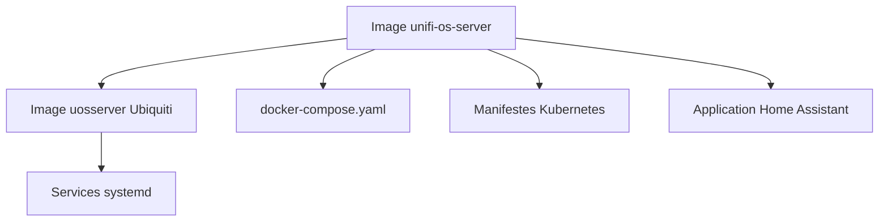

# lemker/unifi-os-server

> Containerizes UniFi OS Server to run it in Docker, Kubernetes or Home Assistant.

## The problem
UniFi OS Server ships as an installer, which is hard to run cleanly in a container.

## What it actually does
Provides a `unifi-os-server` image that adapts the image extracted from Ubiquiti (directories, environment variables). Offers a `docker-compose.yaml`, Kubernetes manifests and a Home Assistant app. Lists the many ports to open for device adoption.

## How it is wired

Simplified diagram based on the sheet, no diagram provided.

## Trying it
```bash
set-inform http://$UOS_SYSTEM_IP:8080/inform
```
Command to run on the UniFi device after an SSH connection, once the container is started via `docker-compose.yaml`.

## Cost and gotchas
Free, but the container requires access to the host's `cgroup` and to `tmpfs` since everything runs as systemd services. Kubernetes requires modifying the ingress for extra TCP and UDP ports.

## What it is not
Not an Ubiquiti product nor supported by them. UniFi OS Server remains proprietary software; only the packaging is under AGPL.

## Alternatives
No alternative cited in the README.

## For you
Ignore: concerns UniFi network administration, not data, AI or MLOps work.
