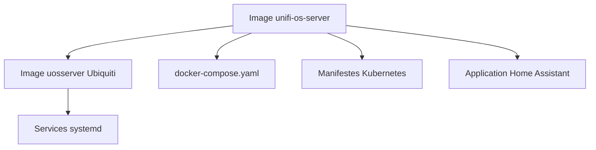

# lemker/unifi-os-server

> Conteneurise UniFi OS Server pour l'exécuter dans Docker, Kubernetes ou Home Assistant.

## Le problème
UniFi OS Server est livré sous forme d'installeur, difficile à faire tourner proprement dans un conteneur.

## Ce que ça fait vraiment
Fournit une image `unifi-os-server` qui adapte l'image extraite d'Ubiquiti (répertoires, variables d'environnement). Propose un `docker-compose.yaml`, des manifestes Kubernetes et une application Home Assistant. Liste les nombreux ports à ouvrir pour l'adoption d'appareils.

## Comment c'est branché

Schéma simplifié d'après la fiche, sans diagramme fourni.

## Essayer
```bash
set-inform http://$UOS_SYSTEM_IP:8080/inform
```
Commande à lancer sur l'appareil UniFi après connexion SSH, une fois le conteneur démarré via `docker-compose.yaml`.

## Coût et pièges
Gratuit, mais le conteneur exige l'accès au `cgroup` de l'hôte et à `tmpfs` car tout tourne en services systemd. Kubernetes demande de modifier l'ingress pour des ports TCP et UDP supplémentaires.

## Ce que ce n'est pas
Pas un produit Ubiquiti ni soutenu par eux. UniFi OS Server reste un logiciel propriétaire, seul le packaging est sous AGPL.

## Alternatives
Aucune alternative citée dans le README.

## Pour toi
À ignorer : concerne l'administration d'un réseau UniFi, pas un travail data, IA ou MLOps.

