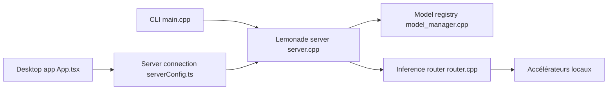

# lemonade-sdk/lemonade

> Local AI server compatible with the OpenAI, Anthropic and Ollama APIs, optimized for AMD NPUs and GPUs.

## The problem
Running chat, speech and images locally on NPU/GPU requires assembling several engines and formats.

## What it actually does
A local service (port 13305) serves LLMs (GGUF, FLM, ONNX), Whisper, speech synthesis and image diffusion, on CPU, GPU or NPU. Model manager, aliases with fallback switching, inference router, VRAM eviction, CLI. An embeddable binary version to integrate into an application. Offloading to the cloud is experimental.

## How it is wired


## Trying it
```bash
lemonade run Gemma-4-E2B-it-GGUF
lemonade list
lemonade pull Gemma-4-E2B-it-GGUF
lemonade backends
lemonade launch claude
```

## Cost and gotchas
Free. Optimized by AMD for Ryzen AI, Radeon and Strix Halo; other configurations work but without that gain. Downloads from Hugging Face or ModelScope. 605 open issues.

## What it is not
Not a host for proprietary models. The README gives no performance figures. Sponsored by AMD, but presented as a community project.

## Alternatives
Ollama: its API is adopted as a compatibility layer, with no other comparison in the README.

## For you
Adopt it to serve models locally with a standard API, especially on AMD hardware; switching clients is limited to the base URL.
