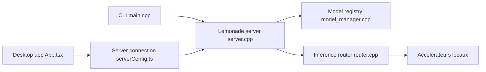

# lemonade-sdk/lemonade

> Serveur d'IA locale compatible API OpenAI, Anthropic et Ollama, optimisé pour NPU et GPU AMD.

## Le problème
Exécuter localement chat, parole et images sur NPU/GPU demande d'assembler plusieurs moteurs et formats.

## Ce que ça fait vraiment
Un service local (port 13305) sert LLM (GGUF, FLM, ONNX), Whisper, synthèse vocale et diffusion d'images, sur CPU, GPU ou NPU. Gestionnaire de modèles, alias avec bascule de secours, routeur d'inférence, éviction de VRAM, CLI. Version embarquable en binaire pour intégrer dans une application. Délestage vers le cloud expérimental.

## Comment c'est branché


## Essayer
```bash
lemonade run Gemma-4-E2B-it-GGUF
lemonade list
lemonade pull Gemma-4-E2B-it-GGUF
lemonade backends
lemonade launch claude
```

## Coût et pièges
Gratuit. Optimisé par AMD pour Ryzen AI, Radeon et Strix Halo ; d'autres configurations marchent mais sans ce gain. Téléchargements depuis Hugging Face ou ModelScope. 605 issues ouvertes.

## Ce que ce n'est pas
Pas un hébergeur de modèles propriétaires. Le README ne chiffre aucune performance. Parrainé par AMD, mais présenté comme projet communautaire.

## Alternatives
Ollama : l'API est reprise comme compatibilité, sans autre comparaison dans le README.

## Pour toi
À adopter pour servir des modèles en local avec une API standard, surtout sur matériel AMD ; changement de client limité à l'URL de base.

