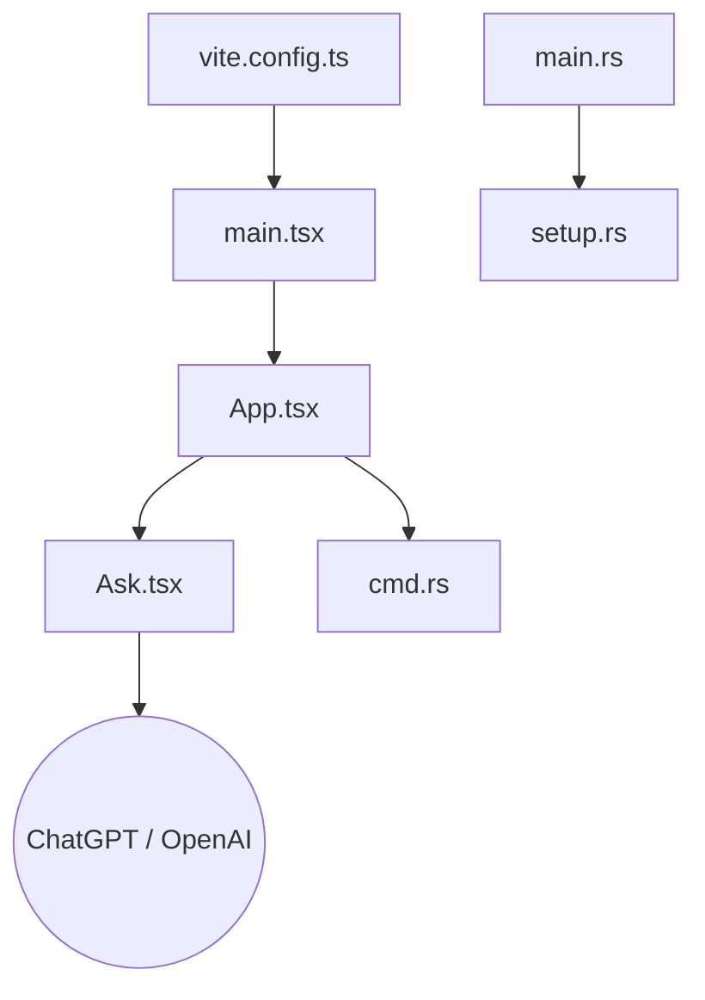

# lencx/ChatGPT

> The Tauri desktop application for ChatGPT was discontinued in favor of an official application and Noi.

## The problem
Accessing ChatGPT within a dedicated desktop window, before the official applications were available.

## What it actually does
Application Tauri: React frontend (Ask, Settings, custom title bar) and Rust backend (windows, configuration, content models, commands). The ChatGPT view uses the OpenAI service. The README announces a planned version 2.0 that has not been implemented and directs users to Noi.

## How it is wired

## Trying it
No documented commands. The README file points to version 1.1.0 (link not provided).

## Cost and gotchas
A ChatGPT account is required. The last update was in August 2024, with 957 open issues and no licenses declared.

## What it is not
Not an official application, not actively maintained, and not a multi-platform client.

## Alternatives
Me (including the author, cited as a successor); the official OpenAI app for macOS.

## For you
Outdated and unlicensed: use the official app or Noi.
