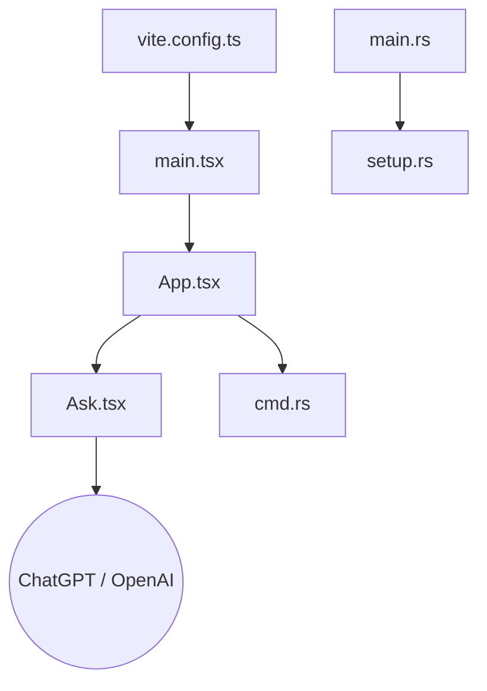

# lencx/ChatGPT

> Enveloppe de bureau Tauri autour de ChatGPT, abandonnée au profit d'une application officielle et de Noi.

## Le problème
Accéder à ChatGPT dans une fenêtre de bureau dédiée, avant l'existence d'applications officielles.

## Ce que ça fait vraiment
Application Tauri : frontend React (vue Ask, vue Settings, barre de titre personnalisée) et backend Rust (fenêtres, configuration, modèles de contenu, commandes). La vue ChatGPT passe par le service OpenAI. Le README annonce une version 2.0 non faite et renvoie vers Noi.

## Comment c'est branché

## Essayer
Aucune commande documentée. Le README renvoie vers la version 1.1.0 (lien non repris).

## Coût et pièges
Un compte ChatGPT est nécessaire. Dernier push en août 2024, 957 issues ouvertes, aucune licence déclarée.

## Ce que ce n'est pas
Pas une application officielle, pas maintenue activement, pas un client multi-modèles.

## Alternatives
Noi (même auteur, citée comme successeur) ; l'application officielle d'OpenAI pour macOS.

## Pour toi
Obsolète et sans licence : prends l'application officielle ou Noi.

