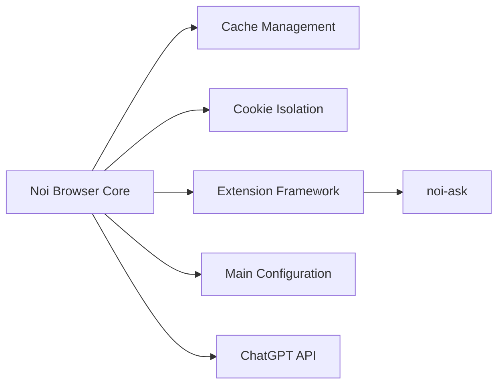

# lencx/Noi

> Desktop browser built around AI chats, with isolated sessions, prompts and an integrated terminal.

## The problem
Juggling several AI chat interfaces (ChatGPT, Claude...) in a regular browser mixes up sessions and prompts.

## What it actually does
According to the feature list: multi-window, session isolation, local data (history, prompts, settings), prompt management, integrated terminal, a `noi` command that can be driven from Claude Code, Codex or Gemini CLI, themes. The architecture describes an Electron app with extensions (`noi-ask`, `noi-export-chatgpt`...) and i18n. The README gives neither installation nor usage details.

## How it is wired

## Trying it
No command documented in the README (only a "Download" link).

## Cost and gotchas
Free; the AI services opened in the browser have their own subscriptions. No license declared: legal reuse of the code is unclear.

## What it is not
Not an API client nor an orchestration tool: it is a browser that wraps the chats' websites. README too thin to judge maturity.

## Alternatives
No alternative named in the README.

## For you
Ignore: a convenience utility with no license and an almost empty README, which brings nothing to data/MLOps work beyond opening chats in tabs.
