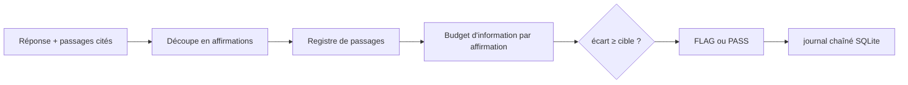

# leochlon/pythea

> Local MCP server, named Berry, that flags LLM claims not supported by the cited sources.

## The problem
An agent states things its context does not support, and fact-checkers do not catch this case.

## What it actually does
For each claim, Berry measures in bits how much the answer depends on the cited passages (information budget, logprobs), compares it to a target and returns PASS or FLAG. A hash-chained SQLite ledger records every decision. The `detect_hallucination` tool is called by the agent. Installation per platform (Claude Code, Codex, Cursor, Gemini, Copilot, Aider…).

## How it is wired


## Trying it
```bash
pipx install -e .
berry init
berry install --platform codex
pytest
```

## Cost and gotchas
Key and backend to supply (`berry setup`), logprobs from a model such as `gpt-4.1-mini` for the benchmarks. Config written into your repository and your profile.

## What it is not
Not a truth checker: it measures support by the cited source. AUROC 0.82–0.93 are pilots from the README, on a single model.

## Alternatives
No alternative named in the README.

## For you
Worth watching: a useful idea for RAG setups where you cite sources, to test on your own data before relying on it.
