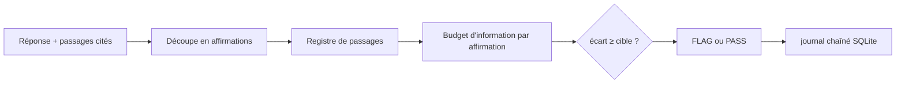

# leochlon/pythea

> Serveur MCP local, nommé Berry, qui signale les affirmations d'un LLM non soutenues par les sources citées.

## Le problème
Un agent affirme des choses que son contexte ne soutient pas, et les vérificateurs de faits ne voient pas ce cas.

## Ce que ça fait vraiment
Pour chaque affirmation, Berry mesure en bits combien la réponse dépend des passages cités (budget d'information, logprobs), compare à une cible et renvoie PASS ou FLAG. Un registre SQLite chaîné par hachage consigne chaque décision. L'outil `detect_hallucination` est appelé par l'agent. Installation par plateforme (Claude Code, Codex, Cursor, Gemini, Copilot, Aider…).

## Comment c'est branché


## Essayer
```bash
pipx install -e .
berry init
berry install --platform codex
pytest
```

## Coût et pièges
Clé et backend à fournir (`berry setup`), logprobs d'un modèle type `gpt-4.1-mini` pour les benchmarks. Config écrite dans ton dépôt et ton profil.

## Ce que ce n'est pas
Pas un vérificateur de vérité : il mesure le soutien par la source citée. AUROC 0,82–0,93 sont des pilotes du README, sur un seul modèle.

## Alternatives
Aucune alternative nommée dans le README.

## Pour toi
À surveiller : idée utile pour des RAG où tu cites des sources, à tester sur tes données avant de t'y fier.

