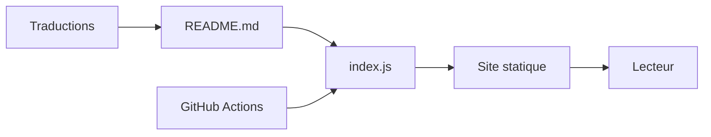

# leonardomso/33-js-concepts

> An online guide to 33 JavaScript concepts, with explanations, examples and resources, for developers.

## The problem
Learning JavaScript without a solid grasp of closures, the event loop or prototypes leads to recurring bugs.

## What it actually does
The README lists the concepts by theme (fundamentals, functions, web platform, OOP, asynchronous, functional, advanced) and extended topics (hoisting, Proxy, browser storage, observers, JSON). Each entry links to a course on 33jsconcepts.com; about forty translations exist. The repository contains mostly text, an `index.js` and a CI.

## How it is wired

## Trying it
No documented command: read the content on 33jsconcepts.com.

## Cost and gotchas
Free, no installation. The exact role of `index.js` and the hosting are inferred by the architecture tool, not confirmed by the README.

## What it is not
Not an interactive course nor a repository of reusable code.

## Alternatives
No alternative named in the README.

## For you
Ignore: JavaScript training content with no direct relevance to a data profile, except to build a front end.
