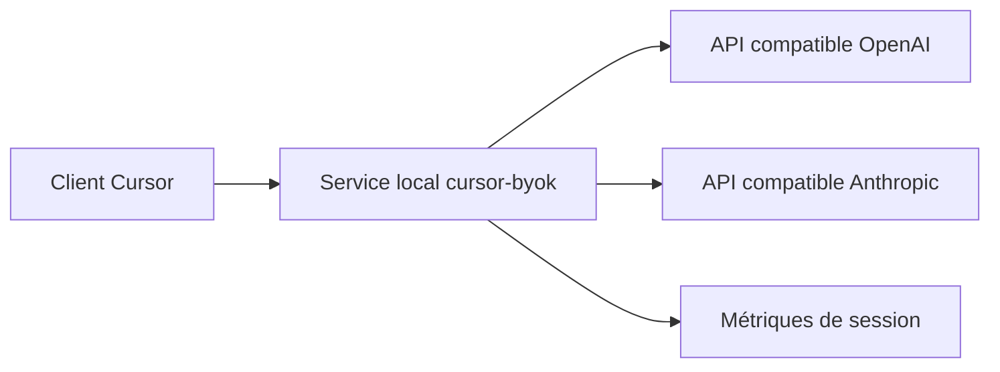

# leookun/cursor-byok

> Local gateway that plugs Cursor into your own OpenAI- or Anthropic-compatible model APIs.

## The problem
Cursor ties its agent features to its models and its billing; using your own credits or providers is not supported.

## What it actually does
A local application (macOS, Windows, Linux) that implements a Cursor backend: it adapts protocols, relays requests to the configured endpoints, coordinates tool calls and keeps the conversation state. Per-model settings (context, max output, reasoning effort, headers), latency tests, session metrics.

## How it is wired


## Trying it
```bash
# Aucune commande documentée : télécharger la version depuis GitHub Releases,
# renseigner endpoint, clé et ID de modèle dans « Model Settings », tester, démarrer le service.
```

## Cost and gotchas
The application is free, model calls are billed by your provider. The repo is archived: no more fixes if Cursor changes its protocol. After a Cursor update, fully restart Cursor.

## What it is not
Not affiliated with Cursor nor endorsed by it. Imitating its backend may violate the product's terms (to be checked). Not maintained.

## Alternatives
No alternative named in the README.

## For you
To ignore: archived, fragile against Cursor's changes and of dubious contractual status; prefer an agent that natively accepts your keys.
