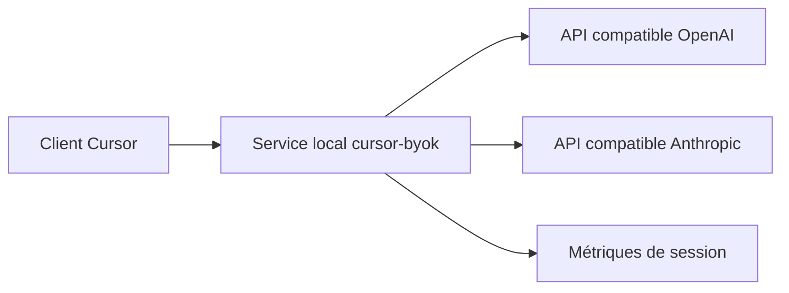

# leookun/cursor-byok

> Passerelle locale qui branche Cursor sur tes propres API de modèles compatibles OpenAI ou Anthropic.

## Le problème
Cursor lie ses fonctions d'agent à ses modèles et à son facturation ; utiliser ses propres crédits ou fournisseurs n'est pas prévu.

## Ce que ça fait vraiment
Une application locale (macOS, Windows, Linux) qui implémente un backend Cursor : elle adapte les protocoles, relaie les requêtes vers les endpoints configurés, coordonne les appels d'outils et garde l'état de conversation. Réglages par modèle (contexte, sortie max, effort de raisonnement, en-têtes), tests de latence, métriques de session.

## Comment c'est branché


## Essayer
```bash
# Aucune commande documentée : télécharger la version depuis GitHub Releases,
# renseigner endpoint, clé et ID de modèle dans « Model Settings », tester, démarrer le service.
```

## Coût et pièges
L'application est gratuite, les appels aux modèles sont facturés par ton fournisseur. Le dépôt est archivé : plus de correctif si Cursor change son protocole. Après une mise à jour de Cursor, redémarrer complètement Cursor.

## Ce que ce n'est pas
Pas affilié à Cursor ni approuvé par lui. L'imitation de son backend peut contrevenir aux conditions du produit (à vérifier). Pas maintenu.

## Alternatives
Aucune alternative nommée dans le README.

## Pour toi
À ignorer : archivé, fragile face aux évolutions de Cursor et d'un statut contractuel douteux ; préfère un agent qui accepte nativement tes clés.

